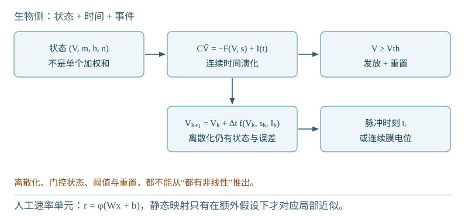

# 生物神经网络与计算机科学／人工智能

神经科学先问一个物质系统怎样产生电信号、改变突触并形成稳定的群体活动；计算机科学先问一个可计算模型怎样表示输入、逼近函数、分配误差并学到任务。两边确实共享非线性、动力学、局部更新与误差校正，但“人工神经元受生物神经元启发”只说明设计来源，不说明人工网络实现了大脑算法。真正值得追踪的是：哪些对应能在写明的模型里严格推出，哪些只是可检验的启发，哪些差异会迫使我们重新设计学习系统。 ^p-opening

这次相遇不只给人工网络添上“更像大脑”的故事。生物侧的实验约束会追问：没有全局损失标签时，局部突触凭什么改变？人工侧的分析也会反过来逼神经科学把“学会了”说成可测量的量，而不是一个拟人化的解释。下面从两边的原问题分头走，允许在阈值、学习与硬件处汇合，也保留无法汇合的地方。 ^p-map

## 两个领域先各自提出问题

生物神经元不是一个接收向量、输出标量的黑箱。它有一层电容性膜，膜两侧的离子浓度不同，电压依赖的离子通道打开或关闭，树突整合输入，轴突起始段参与动作电位的触发，突触前末梢释放递质，突触后膜的受体与细胞内过程改变连接强度。问题至少有三层：这个细胞的电活动怎样由电流平衡产生；一次活动怎样改变突触；许多细胞的活动怎样支持感知、记忆或动作。

人工神经网络也有三层不同的问题。表示层问输入怎样变成内部特征；学习层问参数怎样根据数据与目标改变；部署层问计算、内存、延迟和能耗是否可承受。一个前馈网络写成

$$
\mathbf r^{\ell}=\phi_{\ell}(W^{\ell}\mathbf r^{\ell-1}+\mathbf b^{\ell}),\qquad \mathbf r^0=\mathbf x,
$$

其中 $W^{\ell},\mathbf b^{\ell}$ 是参数，$\phi_{\ell}$ 是激活函数。它可以逼近某类函数，也可以只是对数据的一个压缩表示；是否有用，要由任务、数据分布与验证指标判断。它并没有因此复制神经元的树突、离子通道或神经调质。 ^p-two-systems

两边都常谈“整合”“兴奋”“抑制”“可塑性”，但同名不等于同机制。兴奋在细胞模型中可以指使膜电位去极化的突触电流，在人工单元中却通常只表示一个更大的加权和；抑制电流的符号也取决于所选电流方向约定。可迁移的是把多个输入合并、设置非线性、让连接随活动改变这些计算角色，而不是把角色直接当作生物事实。 ^p-roles

## 膜电位把神经元变成动力系统

先看一个可以严格写出的生物模型。把膜电位记为 $V$，在一个等电位单房室模型中，膜电流平衡给出

$$
C\frac{dV}{dt}=-\bar g_{\rm Na}m^3h(V-E_{\rm Na})-\bar g_{\rm K}n^4(V-E_{\rm K})-\bar g_{\rm L}(V-E_{\rm L})+I(t).
$$

这里 $C$ 是膜电容，$m,h,n$ 是钠、钾通道的门控变量，$E_{\rm Na},E_{\rm K},E_{\rm L}$ 是相应平衡电位；式中外向电流取正号。门控变量自身也按电压依赖的速率方程变化；例如

$$
\frac{dm}{dt}=\alpha_m(V)(1-m)-\beta_m(V)m.
$$

这些方程不是“带权求和再套一个激活函数”的别名。状态不仅有 $V$，还包括通道状态；时间推进是微分方程，输出可以是反复出现的脉冲，也可以是阈下电位。Hodgkin–Huxley 模型的价值在于把 squid 巨轴突的膜电流与动作电位放进同一组可拟合的方程，而不是宣称所有神经元都遵守同一组参数。 ^p-hh

> [!res] 论文 @p-hh
> [Hodgkin 与 Huxley：A quantitative description of membrane current and its application to conduction and excitation in nerve](https://doi.org/10.1113/jphysiol.1952.sp004764)
> 1952 · 膜电流、动作电位与实验参数

把输入项记作 $I(t)$，把其余离子项记作 $-F(V,\mathbf s)$，方程变成

$$
C\dot V=-F(V,\mathbf s)+I(t),\qquad \dot{\mathbf s}=G(V,\mathbf s).
$$

人工网络最熟悉的静态映射 $\mathbf r=\phi(W\mathbf x+\mathbf b)$，在这里只可能对应某个工作点附近的局部输入—输出关系，或某种简化后的速率模型。要得到它，至少需固定状态、线性化动力学并指定输出如何从状态读出；这些步骤增加的内容，不能从“都有非线性”四个字里自动推出。图 1 对照了两条计算路径：生物模型先有状态和时间演化，人工速率模型则直接给出逐步静态映射。 ^p-linearize

> [!figure] 图 1　生物神经元的连续状态与人工单元的静态映射：时间状态不能从加权和中自动得到（本项目原创，MIT）
> 

这也带来一个反向启发：如果人工模型忽略内部状态，它对持续输入、适应与历史效应的预测就可能失真。把循环状态、膜时间常数或突触动力学加进网络，不是为了装饰，而是为了表示特定的时间依赖。反过来，加入这些机制是否改善任务，仍要比较同参数预算下的验证误差，而不是比较图形画得像不像神经元。 ^p-reverse

## 从连续时间到离散更新，哪些东西变了

时间离散化本身是一座严格的桥。若用步长 $\Delta t>0$ 对 $\dot V=f(V,\mathbf s,I)$ 做前向 Euler 更新，得到

$$
V_{k+1}=V_k+\Delta t f(V_k,\mathbf s_k,I_k).
$$

这是原微分方程的一阶近似，误差通常是 $O(\Delta t)$；步长太大时，数值结果可以失真，甚至越过稳定范围。把一个连续时间系统改成离散更新，必须说明近似、采样与稳定性，不能只把 $dt$ 从公式里删掉。

常用的人工脉冲神经元删去通道状态，只保留少量等效变量。一个 leaky integrate-and-fire 模型可以写成

$$
\tau_m\frac{dV}{dt}=-(V-V_{\rm rest})+RI(t),\qquad V\ge V_{\rm th}\Rightarrow\text{发放并重置}.
$$

它保留膜电位与漏电带来的时间行为，却把离子通道、树突形态和多种电流压成一个等效电阻、电容与阈值；上面的基本公式尚未包含绝对不应期，需要时得另加定时重置状态。若 $RI(t)$ 较小，围绕静息电位线性化后，膜对输入表现为低通滤波；这与人工循环网络的一阶线性状态方程有可推导的对应。但发放与重置引入分段、事件和不可逆过程，不能因此说它与普通激活函数等价。 ^p-lif

最关键的差异是输出协议。人工速率单元可以在每个计算步返回连续值；脉冲单元返回的是一串事件时刻 $t_i$。若用短窗口 $T$ 内的计数近似速率，则

$$
\hat r=\frac{1}{T}\sum_i\mathbf 1_{[0,T]}(t_i).
$$

窗口足够长、脉冲数足够多时，计数可以逼近平均发放率；窗口变短时，同一个平均速率也能对应完全不同的时间模式。频率、首次脉冲延迟与群体同步不是同一种信息，选择哪一种表示，应先问任务需要什么，再选模型。 ^p-code

## 阈值不是一个固定电压

“输入够大就输出”只是人工单元最容易写出的规则。真实细胞的阈值受通道状态、输入历史、位置、离子环境与刺激波形影响。对上面的动力系统，能否发放取决于状态 $(V,\mathbf s)$ 是否进入能够产生大振幅脉冲的轨迹；瞬时 $V$ 相同，过去不同，下一步也可能不同。因此“达到某个电压就必发放”既不是 Hodgkin–Huxley 模型的普遍结论，也不能无解释地搬回生物侧。 ^p-threshold

数学上可以讨论确定性的阈值：在指定模型与输入波形下，分开发放与不发放轨迹的边界。实验上测到的阈值却还包含噪声、测量精度与刺激定义。把二者混在一起，会把一个模型分界面当成细胞的普遍常数；反过来，完全否认模型阈值，又会失去可计算的预测。

人工网络的阈值也有自己的版本。逻辑回归在 $z=0$ 处分界面，Softmax 的输出由多个 logit 的相对大小决定，ReLU 在零点改变斜率。它们都能产生决策或非线性，却都不必对应“神经元点火”。把激活函数称为“兴奋”，可以帮助建立直觉；把决策面称为“轴突起始段”，则已经越过了模型边界。 ^p-decision

## 梯度能反向走，信用却未必能

前馈人工网络最坚实的一座桥是链式法则。取一个标量损失 $L$，令

$$
\mathbf z^{\ell}=W^{\ell}\mathbf r^{\ell-1}+\mathbf b^{\ell},\qquad \mathbf r^{\ell}=\phi_{\ell}(\mathbf z^{\ell}),
$$

在损失与激活可微的点上定义

$$
\boldsymbol\delta^{L}=\nabla_{\mathbf r^L}L\odot\phi_L'(\mathbf z^{L}),
$$

则逐层有

$$
\boldsymbol\delta^{\ell}=(W^{\ell+1})^{\mathsf T}\boldsymbol\delta^{\ell+1}\odot\phi_\ell'(\mathbf z^{\ell}),\qquad
\nabla_{W^\ell}L=\boldsymbol\delta^\ell(\mathbf r^{\ell-1})^{\mathsf T}.
$$

这里 $\odot$ 表示逐元素乘。反向传播首先是**计算梯度的高效算法**，不自动规定生物学如何存储误差，也不自动保证梯度下降找到全局最优。不可微点要用相应的次梯度或平滑近似；饱和、尺度失衡与鞍点也会使训练困难。 ^p-backprop

> [!res] 论文 @p-backprop
> [Rumelhart、Hinton 与 Williams：Learning representations by back-propagating errors](https://doi.org/10.1038/323533a0)
> 1986 · 多层网络、误差反向传播与表示学习

把它用于多层网络时，一个误差信号会沿许多连接往回传，并改变远端参数。生物突触能直接观察的量通常是局部活动、突触前后事件、树突电压与生化状态；它是否拥有一般的全局误差广播，是另一个经验问题。某些模型可以通过反馈连接、局部目标或连续时间动力学构造类似的反向计算，但“能在模型中构造”与“大脑实际这样工作”之间仍需实验判据。

这条差异改变了问题本身：如果只有局部信息，信用怎样分配给远处的历史？如果允许中央训练器提供精确梯度，系统又牺牲了哪些自主性、鲁棒性与能效？人工网络对全局损失的依赖，因此不只是工程选择，也是一张实验设计书——它指出生物学习若存在，需要解释哪一路信息从哪里来。 ^p-credit

## 局部学习怎样承担全局任务

Hebb 式学习把“一起活动”变成增强连接的动机，但一句口号还不够。在线性模型中，若用局部前、后活动累积一个外积，相关项

$$
\Delta W=\eta\,\mathbf r\,\mathbf x^{\mathsf T}
$$

会在输入—输出相关时改变权重，却不会自动消除损失，也不保证特征有用。无约束的正向累积容易让权重共同增大；若只做归一化

$$
W_{ij}^{\rm new}=\frac{w_{ij}}{\sum_k w_{kj}}\sum_k w_{kj}^{\rm old},
$$

总和可以保持不变，但仍需说明输出是否兴奋、误差怎样下降。局部规则必须配稳定性分析，才能从“合理的故事”变成可检查的学习算法。 ^p-hebb

一个更具体的生物机制是 spike-timing-dependent plasticity（STDP）。采用先到先正的常见约定，令 $\Delta t=t_{\rm post}-t_{\rm pre}$，一个成对脉冲模型可写为

$$
\Delta w(\Delta t)=
\begin{cases}
A_+e^{-\Delta t/\tau_+},&\Delta t>0,\\
-A_-e^{\Delta t/\tau_-},&\Delta t\le0.
\end{cases}
$$

它说的是：在这个模型里，突触前脉冲稍早于突触后脉冲时增强，反过来时减弱。Bi 与 Poo 在海马培养神经元中观测到了依赖脉冲时序的突触修改；但曲线形状、时间窗、增强与减弱的条件会随细胞类型、实验方案和突触状态改变。NMDA 受体电压依赖阻断等机制可参与解释重合检测，却不能说所有 STDP 都由同一条分子通路产生。 ^p-stdp

> [!res] 论文 @p-stdp
> [Bi 与 Poo：Synaptic modifications in cultured hippocampal neurons: dependence on spike timing, synaptic strength, and postsynaptic cell type](https://doi.org/10.1523/JNEUROSCI.18-24-10464.1998)
> 1998 · 培养海马神经元中的时序依赖突触修改

局部学习由此面对一个全局问题：一次任务成功，可能涉及很久以前的输入；单个突触只看邻居，怎样知道自己的贡献？一种思路是用资格痕迹保存近期活动，再等全局奖励或神经调质信号调制，形成 eligibility trace 与 reward-modulated STDP 类模型。这是受生物启发的计算方案，有模型内的收敛分析可做；它既不是已经证实的唯一脑机制，也不保证在稀疏奖励下迅速学会复杂任务。 ^p-reward

## 预测误差把两边的残差放到一起

预测处理提供另一条双向路线。它不只把环境信号向前传，也把内部预测向下传，用预测与观测之差更新模型。在一个明确的高斯模型中，设观测为 $\mathbf r$，潜在状态为 $\boldsymbol\mu$，预测为 $\mathbf g(\boldsymbol\mu)$，精度矩阵为固定且正定的 $\boldsymbol\Sigma^{-1}$，其中 $\boldsymbol\Sigma$ 是观测协方差矩阵，则负对数似然中的误差项为

$$
E(\boldsymbol\mu)=\frac12(\mathbf r-\mathbf g(\boldsymbol\mu))^{\mathsf T}\boldsymbol\Sigma^{-1}(\mathbf r-\mathbf g(\boldsymbol\mu)).
$$

若 $\mathbf g$ 可微，梯度下降更新写成

$$
\boldsymbol\mu\leftarrow\boldsymbol\mu-\eta\nabla E
=\boldsymbol\mu+\eta J_{\mathbf g}^{\mathsf T}\boldsymbol\Sigma^{-1}(\mathbf r-\mathbf g(\boldsymbol\mu)).
$$

右端把 Jacobian 的转置作用于误差，与反向传播中的 adjoint 结构相同；但这里最小化的是指定生成模型下的预测误差，网络结构、学习规则与时间过程都可以不同。若 $\mathbf g$ 对 $\boldsymbol\mu$ 是线性的，这就是加权最小二乘：$\boldsymbol\Sigma=I$ 时，残差与模型的列空间按通常内积正交；一般正定精度矩阵对应 $\boldsymbol\Sigma^{-1}$ 内积下的正交条件。于是“残差在哪里”能接回已有的正交投影与最小二乘，同时把不同测量通道的可靠性也保留下来。 ^p-predict

精度 $\boldsymbol\Sigma^{-1}$ 不是装饰。它决定不同误差通道该被相信多少；若精度估计错误，更新方向可能被噪声主导。真实感觉系统还存在适应、延迟、反馈与主动采样，不能由一个静态最小二乘公式包办。神经科学中的预测处理是研究框架，包含多种模型与仍有争议的解释；计算机科学可以借用其误差表示构造推断与学习算法，但不能因此宣布“大脑就是运行这段代码”。 ^p-precision

## 稀疏事件何时真的省能量

神经形态工程把脉冲、局部存储与事件驱动处理带到硬件上。这里的可推导优势是：若一个事件只有在输入或状态变化时才触发，静态稀疏输入可以减少部分运算与内存搬运。它不是“所有神经元网络都更省电”的定理。实际能耗还取决于脉冲总数、模拟精度、数模转换、片上与片外通信、空闲状态和编译器调度。

比较人工网络与脉冲网络时，应先固定任务、输入、精度、延迟和误差上限，再报告端到端能耗。若前者把每个时间步都算完，后者每个脉冲都唤醒全芯片，事件驱动反而可能更贵；若输入本身稀疏且模拟电路泄漏很低，结论可能反过来。公平比较也会影响架构选择：把生物机制照搬进数字 CMOS，未必得到生物系统的能效。 ^p-neuromorphic

这条差异还改变了“智能”的评价。生物系统在变化环境里持续学习，用很少的外部监督；人工系统常用离线大数据与集中训练。若把后者在基准集上的高分当作前者的实现证据，就同时跳过了数据、能量、时间与自主性四道边界。神经形态计算能提出的好问题不是“怎样画得更像大脑”，而是：哪种事件、局部性与记忆机制，能在这四项约束下产生可测的能力增益？ ^p-metrics

## 最小验证：让四种说法分别冒一次险

可以在一台普通电脑上用固定随机种子做一个小实验，不必先声称模拟了大脑。

1. **数值与梯度。** 对 Hodgkin–Huxley 或漏电发放模型取一组公开参数，先在不跨越发放与重置事件的足够光滑轨迹段用两种步长积分，比较膜电位并检查一阶误差是否随步长减半；另在完整轨迹上用同一阈值插值脉冲时刻，避免把网格分辨率误当成生理延迟。再在一个小型可微前馈网络上，用中心差分核对反向传播梯度。若梯度对不上，先查链式法则、激活导数与索引；若积分不收敛，先查步长、刚性与重置实现。
2. **速率与时间。** 给同一漏电发放神经元两串在相同窗口 $[0,T]$ 内具有相同时间平均电流、但时间分布不同的输入，比较计数、首次脉冲延迟与脉冲间隔。为速率单元与脉冲读出选定同一任务、读出与损失，再报告验证误差与延迟。目的是检验“平均输入相同是否足够”，不是预先证明某种编码更优。
3. **局部更新。** 实现一个明确的 STDP 成对脉冲曲线，扫描 $\Delta t$、初始权重、权重边界与脉冲噪声。分别比较纯 STDP、纯 Hebb 外积、带权重边界和稳态约束的版本，观察权重是否发散、任务误差是否下降。没有下降时，不能只把曲线画得更像文献就结束。
4. **受限条件。** 让一个局部学习模型先看见奖励信号，再撤回奖励；或者只在无奖励时训练。检查它学到的是任务结构，还是把奖励出现本身当成特征。把窗宽、噪声、延迟和参数改变后重跑，记录结论在哪一点翻转。

判定标准要事先写下：数值方法应出现预期的收敛阶；梯度误差应落在有限差分精度范围内；局部规则应给出明确的稳定范围或反例；任务比较应同时报告精度、时间步数与运算量。任何一项失败，都可能推翻的是当前模型或当前假设，而不是自动推翻整个神经科学或人工智能。 ^p-experiment

## 把不能共享的部分留下

这次并联最可靠的共同语言，是非线性动力系统、时间离散化、链式法则、残差与带约束的局部更新。它们能支撑严格推导，也能生成新的实验设计。更弱的对应——“预测像推理”“脉冲像事件”“梯度像误差反馈”——只在明确边界后用于启发。数学推导、实验测量、计算建模、类比与猜想，必须分开写；其中一个成立，不会替其他四个作证。

没有解决的新分支恰好从差异长出来：如果信用只能局部传播，哪些任务结构仍可学习？如果脉冲时间携带信息，连续速率表示会丢什么，又能通过什么样的读出补回来？如果预测误差由远端反馈提供，大脑怎样保证反馈不被误当成新感觉？回答这些问题，需要先选定一个可观测系统、一个可计算模型和一个可能的失败条件。那样，“向大脑学习”才会从比喻变成研究。

```vein-graph
{"nodes":[
{"id":"bio","label":"生物神经元","kind":"domain","layer":0},
{"id":"mem","label":"膜电位与电容","kind":"concept","layer":1},
{"id":"channel","label":"离子通道电流","kind":"concept","layer":1},
{"id":"hh","label":"Hodgkin–Huxley 模型","kind":"core","layer":2},
{"id":"spike","label":"动作电位与脉冲时刻","kind":"concept","layer":3},
{"id":"ai","label":"人工神经网络","kind":"domain","layer":0},
{"id":"unit","label":"加权和与激活","kind":"concept","layer":1},
{"id":"rate","label":"速率表示","kind":"concept","layer":2},
{"id":"dynamics","label":"连续时间动力系统","kind":"structure","layer":3},
{"id":"discrete","label":"时间离散化","kind":"method","layer":3},
{"id":"lif","label":"漏电发放神经元","kind":"concept","layer":2},
{"id":"threshold","label":"动态阈值与状态","kind":"concept","layer":3},
{"id":"loss","label":"全局任务损失","kind":"item","layer":0},
{"id":"backprop","label":"反向传播梯度","kind":"method","layer":2},
{"id":"chain","label":"链式法则与伴随","kind":"structure","layer":3},
{"id":"credit","label":"信用分配问题","kind":"idea","layer":3},
{"id":"local","label":"局部突触更新","kind":"item","layer":0},
{"id":"hebb","label":"Hebb 外积规则","kind":"method","layer":2},
{"id":"stdp","label":"STDP 时序窗口","kind":"concept","layer":2},
{"id":"reward","label":"奖励调制的局部学习","kind":"idea","layer":3},
{"id":"predict","label":"内部预测","kind":"item","layer":0},
{"id":"error","label":"预测误差","kind":"concept","layer":2},
{"id":"precision","label":"误差精度","kind":"concept","layer":2},
{"id":"residual","label":"正交补中的残差","kind":"concept","layer":3,"ref":"n.orthogonality"},
{"id":"ls","label":"最小二乘","kind":"concept","layer":1,"ref":"n.least-squares"},
{"id":"event","label":"脉冲事件与稀疏计算","kind":"item","layer":0},
{"id":"hardware","label":"神经形态硬件","kind":"idea","layer":2},
{"id":"energy","label":"端到端能耗","kind":"concept","layer":3},
{"id":"experiment","label":"数值与学习对照实验","kind":"method","layer":4},
{"id":"evidence","label":"证据层级","kind":"structure","layer":5}
],"edges":[
{"id":"b-mem-hh","from":"mem","to":"hh","type":"applies-to","label":"电容与电流平衡","explanation":"膜电容的电流平衡与离子通道门控方程共同定义 Hodgkin–Huxley 动力系统。","assumptions":["等电位单房室模型","离子电流按所写符号约定"],"epistemic":"logically-derived","track":"C1"},
{"id":"b-channel-hh","from":"channel","to":"hh","type":"applies-to","label":"通道电流进入模型","explanation":"电压依赖的钠钾电流与门控变量决定膜电位轨迹和动作电位形状。","assumptions":["采用指定离子电流模型"],"epistemic":"source-backed","sources":["https://doi.org/10.1113/jphysiol.1952.sp004764"],"track":"C1"},
{"id":"b-hh-spike","from":"hh","to":"spike","type":"derives-from","label":"状态演化产生脉冲","explanation":"膜电位与门控状态的非线性耦合可产生动作电位，脉冲是连续轨迹中的事件。","assumptions":["参数处于可兴奋区域"],"epistemic":"logically-derived","track":"C1"},
{"id":"b-hh-dynamics","from":"hh","to":"dynamics","type":"applies-to","label":"写成状态方程","explanation":"把膜电位与门控变量作为状态后，神经元可表示为连续时间动力系统。","assumptions":["状态变量与速率函数已指定"],"epistemic":"logically-derived","track":"C1"},
{"id":"b-ai-unit","from":"ai","to":"unit","type":"defined-by","label":"前馈单元","explanation":"人工单元由加权输入、偏置和激活函数定义，输出通常不携带膜电位状态。","assumptions":["使用前馈速率网络"],"epistemic":"logically-derived","track":"C1"},
{"id":"b-unit-rate","from":"unit","to":"rate","type":"applies-to","label":"连续激活作为速率","explanation":"连续激活值可作为某种速率表示，但不自动对应生物脉冲计数或时间编码。","assumptions":["明确激活值的归一化与解释"],"epistemic":"logically-derived","track":"C1"},
{"id":"b-dynamics-discrete","from":"dynamics","to":"discrete","type":"applies-to","label":"状态方程数值化","explanation":"连续时间状态方程可用前向 Euler 等方法离散化，局部截断误差随步长减小。","assumptions":["解足够光滑","步长位于稳定范围"],"epistemic":"logically-derived","track":"C1"},
{"id":"b-dynamics-lif","from":"dynamics","to":"lif","type":"applies-to","label":"保留膜时间常数","explanation":"漏电发放模型保留膜电位的积分与漏电，但删除多种离子通道和树突状态。","assumptions":["\u4fdd\u7559\u819c\u79ef\u5206\u4e0e\u6f0f\u7535\u4f46\u5220\u9664\u79bb\u5b50\u901a\u9053\u52a8\u529b\u5b66"],"epistemic":"logically-derived","track":"C1"},
{"id":"b-lif-threshold","from":"lif","to":"threshold","type":"derives-from","label":"状态决定是否发放","explanation":"发放由膜电位阈值与重置规则触发，而膜电位本身依赖输入历史。","assumptions":["采用指定阈值与重置规则","讨论不应期时另行声明"],"epistemic":"logically-derived","track":"C1"},
{"id":"b-lif-rate","from":"lif","to":"rate","type":"applies-to","label":"计数读出平均速率","explanation":"在足够长的计数窗口内，脉冲次数除以窗长可近似平均发放率。","assumptions":["窗长足够且采样稳定"],"epistemic":"logically-derived","track":"C1"},
{"id":"b-threshold-unit","from":"threshold","to":"unit","type":"contrasts-with","label":"生物状态非固定阈值","explanation":"生物阈值依赖状态与历史，人工单元的固定分界面只是简化计算选择。","assumptions":["比较指定动力系统与前馈单元"],"epistemic":"logically-derived","track":"C1"},
{"id":"b-loss-backprop","from":"loss","to":"backprop","type":"applies-to","label":"损失梯度驱动更新","explanation":"反向传播高效计算损失对多层网络参数的梯度，为梯度下降提供更新方向。","assumptions":["损失与激活在计算点可微"],"epistemic":"source-backed","sources":["https://doi.org/10.1038/323533a0"],"track":"C1"},
{"id":"b-backprop-chain","from":"backprop","to":"chain","type":"derives-from","label":"链式法则","explanation":"逐层伴随矩阵由后层梯度、权重转置和局部激活导数递推得到。","assumptions":["前馈计算图已定义"],"epistemic":"logically-derived","track":"C1"},
{"id":"b-chain-backprop","from":"chain","to":"backprop","type":"applies-to","label":"转置作用于误差","explanation":"链式法则的伴随结构与某些预测误差更新中的 Jacobian 转置相同。","assumptions":["比较线性化计算图"],"epistemic":"logically-derived","track":"C1"},
{"id":"b-backprop-credit","from":"backprop","to":"credit","type":"applies-to","label":"远端误差传到参数","explanation":"全局损失梯度把任务误差分配给多层参数，凸显局部突触缺少同类全局信号的问题。","assumptions":["网络使用集中训练目标"],"epistemic":"logically-derived","track":"C1"},
{"id":"b-backprop-bio","from":"backprop","to":"bio","type":"analogy-to","label":"算法不证明脑机制","explanation":"人工反向传播与生物误差处理可作比较，但算法成功不证明大脑执行同一计算。","assumptions":["仅比较信息处理功能"],"epistemic":"analogy","boundary":"没有生理证据证明一般生物网络实现全局损失的反向广播","track":"C2"},
{"id":"b-local-hebb","from":"local","to":"hebb","type":"applies-to","label":"局部活动累积","explanation":"线性 Hebb 外积规则用局部前后活动改变权重，但不自动最小化任务损失。","assumptions":["前后活动可直接观测","忽略权重边界"],"epistemic":"logically-derived","track":"C1"},
{"id":"b-hebb-local","from":"hebb","to":"local","type":"contrasts-with","label":"相关不等于学习","explanation":"共同活动导致权重增长，可能只放大相关，并不保证学到有用的任务特征。","assumptions":["缺少任务误差或稳定约束"],"epistemic":"logically-derived","track":"C1"},
{"id":"b-stdp-local","from":"stdp","to":"local","type":"applies-to","label":"时序限定局部更新","explanation":"STDP 根据突触前后脉冲时间差改变权重，更新主要由局部事件决定。","assumptions":["指定脉冲协议与权重边界"],"epistemic":"source-backed","sources":["https://doi.org/10.1523/JNEUROSCI.18-24-10464.1998"],"track":"C1"},
{"id":"b-local-reward","from":"local","to":"reward","type":"applies-to","label":"痕迹等待全局调制","explanation":"局部资格痕迹可与奖励或神经调质信号结合，形成受启发的信用分配模型。","assumptions":["奖励信号延迟且带噪声","模型内指定更新规则"],"epistemic":"analogy","boundary":"局部痕迹与奖励调制的具体生物实现和任务有效性仍需实验验证","track":"C2"},
{"id":"b-predict-error","from":"predict","to":"error","type":"derives-from","label":"观测减预测","explanation":"给定内部预测后，观测与预测之差构成模型中的预测误差。","assumptions":["生成模型与观测已指定"],"epistemic":"logically-derived","track":"C1"},
{"id":"b-error-precision","from":"error","to":"precision","type":"applies-to","label":"按通道精度加权","explanation":"高斯模型下不同误差通道按精度加权，精度决定更新对噪声的敏感程度。","assumptions":["高斯似然","固定且正定的精度矩阵"],"epistemic":"logically-derived","track":"C1"},
{"id":"b-error-residual","from":"error","to":"residual","type":"analogy-to","label":"看解释不了的残差","explanation":"预测误差与最小二乘残差都可借用残差与正交补检查模型解释不了的方向，但两者的适用条件必须写明。","assumptions":["仅比较线性最小二乘最优点","非单位精度使用 Σ 逆内积"],"epistemic":"analogy","boundary":"非线性模型一般只在最优点满足加权切空间正交，不保证对整个模型列空间正交","track":"C2"},
{"id":"b-ls-residual","from":"ls","to":"residual","type":"applies-to","label":"正交补定位残差","explanation":"最小二乘残差与拟合子空间正交，正交补给出不可由当前模型解释的方向。","assumptions":["欧氏内积与线性列空间"],"epistemic":"logically-derived","track":"C1"},
{"id":"b-predict-bio","from":"predict","to":"bio","type":"analogy-to","label":"框架不等于脑代码","explanation":"预测处理为感觉系统提供可检验框架，但不能把某一实现公式等同为全脑算法。","assumptions":["仅比较预测与误差组织方式"],"epistemic":"analogy","boundary":"不同区域与任务可能采用不同机制，框架不构成唯一全脑解释","track":"C2"},
{"id":"b-event-hardware","from":"event","to":"hardware","type":"applies-to","label":"事件驱动硬件","explanation":"稀疏事件可触发局部计算，硬件设计可围绕脉冲与局部状态组织。","assumptions":["事件产生有效稀疏性","计入硬件开销"],"epistemic":"logically-derived","track":"C1"},
{"id":"b-hardware-energy","from":"hardware","to":"energy","type":"applies-to","label":"节省取决于全链路","explanation":"神经形态硬件的能耗优势取决于任务、精度、转换、通信与实现，不随脉冲形式自动成立。","assumptions":["端到端同任务同精度比较"],"epistemic":"logically-derived","track":"C1"},
{"id":"b-hardware-energy2","from":"hardware","to":"energy","type":"analogy-to","label":"稀疏不保证省电","explanation":"事件驱动看似省运算，但密集脉冲与转换开销可能抵消收益，必须实测。","assumptions":["仅作设计启发"],"epistemic":"analogy","boundary":"不能由脉冲或脑启发结构推断端到端能耗必然更低","track":"C2"},
{"id":"b-experiment-hh","from":"experiment","to":"hh","type":"applies-to","label":"步长减半检验数值","explanation":"对同一状态轨迹用不同步长积分并比较脉冲时刻，可检查离散化误差与实现。","assumptions":["固定参数与输入","采用已知阶数的积分器"],"epistemic":"logically-derived","track":"C1"},
{"id":"b-experiment-backprop","from":"experiment","to":"backprop","type":"applies-to","label":"有限差分核对梯度","explanation":"在可微点用中心差分扰动参数，可独立检验反向传播梯度实现。","assumptions":["选择合适扰动尺度","避开不可微点"],"epistemic":"logically-derived","track":"C1"},
{"id":"b-experiment-stdp","from":"experiment","to":"stdp","type":"applies-to","label":"扫描时序与噪声","explanation":"扫描时间窗、权重边界与噪声，可区分协议效应、实现不稳定与规则失效。","assumptions":["记录完整参数与随机种子"],"epistemic":"logically-derived","track":"C1"},
{"id":"b-experiment-evidence","from":"experiment","to":"evidence","type":"derives-from","label":"结果与解释分层","explanation":"数值、任务与机制实验分别提供证据，结论必须按推导、测量、模型与推断分别陈述。","assumptions":["预先指定观察指标与失败条件"],"epistemic":"logically-derived","track":"C1"},
{"id":"b-evidence-bio","from":"evidence","to":"bio","type":"applies-to","label":"机制结论需生理证据","explanation":"计算模型中的成功只能支持该模型，要推出生物机制还需相应的生理与行为证据。","assumptions":["区分模型预测与实证观察"],"epistemic":"logically-derived","track":"C1"},
{"id":"b-evidence-ai","from":"evidence","to":"ai","type":"applies-to","label":"任务结论需对照","explanation":"人工模型的能力主张需要同任务同预算对照，不能仅由结构相似推出。","assumptions":["固定验证集、精度与资源预算"],"epistemic":"logically-derived","track":"C1"}
]}
```
