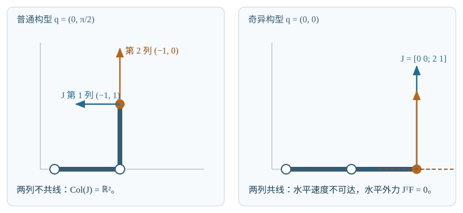

# 机械臂的每一个瞬间是一个矩阵

机器人先有一个非线性问题：给定关节角，末端在哪里；给定末端运动，关节该怎么动；给定末端受力，关节该出多大力矩。线性代数先有一个线性问题：一个矩阵把哪些输入送到哪些输出，哪些输入被压成零，哪些输出无法到达，怎样逆转或近似逆转它。两边在“微分”处接上，但接上的不是一个可以包办全部机器人学的对象，而是一种可检验的对应：固定构型时，末端速度对关节速度是线性的。 ^p-intro

这个相遇至少改变三件事。它让运动学问题能借用子空间与分解；让线性代数的转置、零空间、奇异值获得力学意义；也让机器人暴露出线性代数常略过的问题——矩阵随构型改变、方向带有单位、几何量并非向量、真实执行还有力矩与速度上限。下面从这些问题分头走，不强行把所有联系塞进同一个公式。 ^p-map

> [!res] 书 @p-intro
> [Lynch 与 Park：Modern Robotics](https://hades.mech.northwestern.edu/index.php/Modern_Robotics)
> 第 3、5、6 章 · 作者公开全书与视频

## 从非线性位置到瞬时线性速度

平面两连杆机械臂，杆长都为 1，关节角为 $q_1,q_2$，末端位置是 ^p-fk

$$x=\cos q_1+\cos(q_1+q_2),\qquad y=\sin q_1+\sin(q_1+q_2).$$

这里没有“末端位置对关节角是线性的”这回事。但对时间求导，固定 $\mathbf q=(q_1,q_2)$ 时得到

$$
\begin{bmatrix}\dot x\\\dot y\end{bmatrix}
=\underbrace{\begin{bmatrix}
-\sin q_1-\sin(q_1+q_2)&-\sin(q_1+q_2)\\
\cos q_1+\cos(q_1+q_2)&\cos(q_1+q_2)
\end{bmatrix}}_{J(\mathbf q)}
\begin{bmatrix}\dot q_1\\\dot q_2\end{bmatrix}.
$$

$J$ 是正运动学函数 $\mathbf p=f(\mathbf q)$ 的雅可比矩阵，$\mathbf v=J\dot{\mathbf q}$ 是**精确的瞬时关系**，不是“末端位置近似线性”。若在一个有限时间段内 $\mathbf q$ 变化，$J$ 通常也变化，把速度积分回去不能简单写成 $\Delta\mathbf p=J\Delta\mathbf q$。把三角函数留在矩阵里，线性的是输入与输出的关系，不是几何本身。 ^p-diff

这条联系向上接的是微分几何：光滑流形在一点的切空间，本来就是曲线一阶变化的线性模型。向下接的是控制：关节控制器给出 $\dot{\mathbf q}$，末端速度由此确定。机器人因此给线性代数补上一个时间尺度：课堂上的矩阵是固定的，机器人里的矩阵是沿着构型变化的“一族线性映射”。 ^p-tangent

> [!xref] 知识链接 @p-tangent
> 这里复用了[[2.1-列空间中的最近点|第 2 章第 1 节　正交投影与最小二乘法]]中的列空间：同一个 $J$，在不同问题里分别表示可达速度与最小二乘的列方向，但物理含义不能互相替代。

## 子空间一旦有了身体

取 $\mathbf q=(0,\tfrac\pi2)$，末端在 $(1,1)$，且

$$J=\begin{bmatrix}-1&-1\\1&0\end{bmatrix}.$$

此时两列线性无关，$\operatorname{Col}(J)=\mathbb R^2$：在关节速度不受限的理想模型里，末端此刻可以朝任何方向运动。若固定其他关节并只考察某些自由度，就必须取相应的子矩阵；不能拿完整机械臂的雅可比代替局部结论。

另一组问题是：哪些关节运动在这一瞬间不改变末端？它们满足 $J\dot{\mathbf q}=0$，组成 $\ker J$。本例 $\ker J=\{0\}$。若一个机械臂有 7 个关节、任务只约束 6 维末端速度，则矩阵是 $6\times7$；在行满秩的普通构型下，$\ker J$ 至少一维。冗余并不自动保证每个目标都可达，它保证的是：**在已经可达的速度中**，至少还有不改变末端的参数方向。 ^p-subspace

这里出现一条值得带回去的读法：列空间回答“输出能到哪里”，零空间回答“哪些输入被吞掉”。线性代数把它们定义成集合，机器人给它们配上动作——手可以移动，肘可以自运动。但“可以自运动”若从瞬时推广到有限路径，还需要额外条件：在 $J(\mathbf q_0)$ 满行秩且附近保持常秩时，隐函数定理允许把零空间中的切向量积分成一条局部端点固定的曲线。瞬时 $J\dot{\mathbf q}=0$ 本身只说明这一瞬间末端速度为零。 ^p-finite

## 转置为什么是力的一侧

现在换问题：不驱动关节，而是在末端施加力 $\mathbf F$，求维持静力平衡所需的关节力矩 $\boldsymbol\tau$。对理想、无摩擦、不计惯性力的刚体机械臂，采用 $\mathbf F$ 为末端外力的广义力记号，功率相等给出 ^p-force

$$\boldsymbol\tau^{\mathsf T}\dot{\mathbf q}=\mathbf F^{\mathsf T}\mathbf v=\mathbf F^{\mathsf T}J\dot{\mathbf q}.$$

由于它对任意 $\dot{\mathbf q}$ 都成立，$\boldsymbol\tau=J^{\mathsf T}\mathbf F$。所以转置不是“把行和列对调”的语法操作，而是同一台机器从运动到力的对偶映射。行向量与列向量在纸上不同，在这里对应的是输入侧与输出侧的功的配对。

这也解释了四个基本子空间为什么值得一起学。末端力 $\mathbf F$ 若满足 $J^{\mathsf T}\mathbf F=0$，就在 $\ker J^{\mathsf T}$ 中；理想静力模型下，它不需要关节施加力矩，而由连杆、轴承或外部支撑承担。$\ker J^{\mathsf T}$ 是 $\operatorname{Col}(J)$ 的正交补，因此“末端此刻不能产生的速度方向”与“不需要关节力矩就能平衡的力方向”对上了。这个对上有前提：采用同一组广义坐标与欧氏配对，并且讨论的是理想静力；把它直接说成“任何真实结构都能无限承受这个力”，就跨过了模型的边界。 ^p-duality

> [!res] 视频 @p-force
> [MIT 18.06 第 10 讲　四个基本子空间](https://ocw.mit.edu/courses/18-06-linear-algebra-spring-2010/resources/lecture-10-the-four-fundamental-subspaces/)
> 列空间、零空间与正交补

动力学里还有一条容易混淆的公式。典型方程可写为

$$M(\mathbf q)\ddot{\mathbf q}+C(\mathbf q,\dot{\mathbf q})\dot{\mathbf q}+\mathbf g(\mathbf q)=\boldsymbol\tau+J^{\mathsf T}\mathbf F_{\rm ext}.$$

这里的 $J^{\mathsf T}\mathbf F_{\rm ext}$ 是外力项，不是“总关节力矩”本身。总力矩还要平衡惯性、科里奥利项与重力。静态公式是忽略这些项后的特例，不是动力学公式的别名。 ^p-dynamics

## 奇异位形暴露了“瞬时”与“有限”的差别

把手臂伸直，取 $q_1=q_2=0$，则末端在 $(2,0)$，

$$J=\begin{bmatrix}0&0\\2&1\end{bmatrix}.$$

两列都沿 $y$ 方向，秩从 2 降到 1。此刻末端不能沿手臂方向产生速度；同时 $J^{\mathsf T}(1,0)^{\mathsf T}=0$，理想静力模型下，沿手臂方向的外力不需要关节力矩来平衡。两个现象由同一个降秩联系起来：列空间缩成一维，左零空间增加一维。图 1 把普通构型与伸直构型并排，直接比较雅可比两列是否还张成两个方向。 ^p-singular

> [!figure] 图 1　两连杆机械臂的普通与奇异构型：雅可比列方向由不共线变为共线（本项目原创，MIT）
> 

但“奇异”不是一个只有“是/否”的标签。让 $\dot{\mathbf q}$ 遍历单位圆，$J\dot{\mathbf q}$ 的图像一般是椭圆，半轴长度是奇异值；最小奇异值接近零时，椭圆变扁。它确实提醒我们某些方向上输出被压得很小，却不是带单位的“到奇异位形的距离”：奇异值依赖关节角、角速度、线速度的单位与缩放，而构型是否奇异还取决于整个邻域中的秩行为。

同样，靠近奇异构型不意味着所有期望速度都会失控。若期望速度落在当前可达列空间中，适当选一个最小范数解仍可能有限；若它含有不可达分量，问题首先是无解，而不是“除以一个很小的数”这么简单。奇异性、条件数、可达性、执行器限制是相关但不同的判断。 ^p-scale

零空间也要分层读。伸直时 $\dot{\mathbf q}=(1,-2)^{\mathsf T}$ 满足 $J\dot{\mathbf q}=0$，末端这一瞬间不动。要问“能否沿着这条路真正回到同一末端位姿”，需考察沿有限路径的 $J(\mathbf q(t))$，或使用局部满行秩下的隐函数定理；不能只凭一个瞬时核向量断言存在一条自运动曲线。 ^p-selfmotion

## 逆问题：同一方程，不同目标

给定期望末端速度 $\mathbf v$，求 $\dot{\mathbf q}$，就是解 $J\dot{\mathbf q}=\mathbf v$。可解当且仅当 $\mathbf v\in\operatorname{Col}(J)$。有解时，若 $\mathbf z_0$ 是一个特解，则全部解是

$$\dot{\mathbf q}=\mathbf z_0+\ker J.$$

选择哪一个特解，是一个设计问题。$J^+\mathbf v$ 给出欧氏长度最小的关节速度，但真实机器人未必把“关节速度平方和最小”当作最优目标；还可能关心力矩、能量、避障、关节极限、加速度平滑或姿态误差。伪逆是清晰可算的选择，不是物理定律。 ^p-inverse

若 $J$ 行满秩，则 $J^+=J^{\mathsf T}(JJ^{\mathsf T})^{-1}$。这个公式不能无条件用于任意矩阵：$JJ^{\mathsf T}$ 不可逆时，要用 SVD 定义伪逆，或换用其他适当的最小二乘解。特别地，奇异位形下期望速度不可达时，普通伪逆只最小化速度误差，不会创造那个缺失的方向。 ^p-pinv

> [!res] 视频 @p-inverse
> [MIT 18.06 第 33 讲　左逆、右逆与伪逆](https://ocw.mit.edu/courses/18-06-linear-algebra-spring-2010/resources/lecture-33-left-and-right-inverses-pseudoinverse/)
> 最小范数解与伪逆

工程中常用阻尼最小二乘 ^p-dls

$$\dot{\mathbf q}=J^{\mathsf T}(JJ^{\mathsf T}+\lambda^2I)^{-1}\mathbf v.$$

它求解 $\min_{\dot{\mathbf q}}\lVert J\dot{\mathbf q}-\mathbf v\rVert^2+\lambda^2\lVert\dot{\mathbf q}\rVert^2$。在奇异值方向上，跟踪增益从 $1/\sigma$ 变为 $\sigma/(\sigma^2+\lambda^2)$，放大被限制；代价是产生跟踪误差。这不是“把机器人变成精确的逆”，而是明确选择：宁可有一点误差，也不让解无界。数值分析中的吉洪诺夫正则化给出同样的代数结构，但 $\lambda$ 在机器人里还有控制带宽、安全与任务误差方面的含义。把阻尼项说成“像装了一个物理弹簧”只能作为 C2 类比；它不是由这个算法自动产生的刚度。 ^p-reg

## 差异继续长出问题

机器人不只是给线性代数找应用，它也反过来追问线性代数的模型。

**从向量到流形。** 平面内绕同一轴的转角可以相加，$SO(2)$ 与向量群同构；三维一般转动不可交换，两个旋转的先后次序会改变结果，$SO(3)$ 不是普通向量空间。但 $SO(3)$ 在单位元处的切空间仍可线性化，李代数与矩阵指数提供另一座桥。这里共享的是“用切空间处理局部变化”的思想，不是“位姿可以当向量直接相加”。

**从矩阵到一族矩阵与度量。** 雅可比随 $\mathbf q$ 改变；广义坐标、单位、质量分布与传感器又会改变“小”的含义。把关节速度按质量度量加权，最小范数运动不一定对应最小动能。换基会改变矩阵表示，但不会改变线性映射本身；奇异值数值是否改变，要看是否同时对输入与输出施加一致的度量缩放。机器人让“坐标不变”从课堂原则变成工程检查。

**从乘法的转置到反向传播。** 对一个可微计算 $y=f(x)$，损失 $L(y)$ 关于 $x$ 的梯度为 $\nabla_xL=Df(x)^{\mathsf T}\nabla_yL$。这与 $J^{\mathsf T}$ 在形式上同构，都来自链式法则与对偶配对。但自动微分里的梯度是损失对参数的变化率，不是机械臂受到的物理力；只有在特定能量函数下，负梯度才可以被解释为力。数学结构相同，物理身份不能凭形式相同就授予。 ^p-backprop

**从局部模型到有限自运动。** 这是上面差异自然长出的研究问题：在保持秩的构型区域内，哪些瞬时零空间方向能积分成端点固定的有限运动？答案涉及路径积分、约束流形与拓扑，不是再一次调用矩阵秩就能结束。 ^p-research

## 把联系变成能失败的检验

抽象对应是否可信，可以用一个最小实验拆开检验。取前述两连杆机构，记录构型、$J(\mathbf q)$、给定关节速度 $\dot{\mathbf q}$ 和短时间 $\Delta t$ 内的末端位移。分别比较：

1. 用 $\Delta\mathbf p\approx J(\mathbf q)\Delta t$ 预测的一阶位移；
2. 用有限差分 $\lVert f(\mathbf q+\dot{\mathbf q}\Delta t)-f(\mathbf q)\rVert$ 得到的真实位移；
3. 把 $\Delta t$ 缩小后，位移误差是否按预期接近二阶。

如果误差不随步长下降，先检查微分实现、时间单位与坐标约定，而不是宣称“雅可比不成立”。这个实验验证的是局部线性化，不能验证力矩公式；静力关系需要另一组实验：测量外力、关节力矩，检查功率或虚功是否平衡，并说明摩擦、重力与传感器误差。 ^p-experiment

把两条路线分开，证据等级也就清楚了。$\mathbf v=J\dot{\mathbf q}$ 来自定义与求导；$\boldsymbol\tau=J^{\mathsf T}\mathbf F$ 来自理想静力模型的功的平衡；阻尼最小二乘来自选定的优化目标；“梯度就是力”与“阻尼就是弹簧”若不作额外假设，都只是启发。数学推导、实验测量、模型推断、类比与猜想，不应挤在同一句“共享”里。 ^p-evidence

最后一个分叉通向已有网络：把最小二乘的“不可达分量”与机器人中的“速度不可达方向”并排看，它们都是某个线性映射的像之外的残差；但一个比较预测与观测，另一个比较期望与可实现。能否把这种“看残差落在哪个正交补”的动作迁移到传感器校准或故障诊断？先选一个具体系统，写出残差、正常范围与可观测条件，再决定它是不是同一个问题。

```vein-graph
{"nodes":[
{"id":"fk","label":"非线性正运动学","kind":"item","layer":0},
{"id":"jac","label":"雅可比矩阵 J","kind":"core","layer":1},
{"id":"tangent","label":"切空间与微分","kind":"structure","layer":2},
{"id":"vel","label":"瞬时速度关系 v = Jq̇","kind":"concept","layer":3},
{"id":"reach","label":"可达速度","kind":"item","layer":0},
{"id":"cs","label":"列空间","kind":"concept","layer":1,"ref":"n.colspace"},
{"id":"self","label":"瞬时自运动","kind":"item","layer":0},
{"id":"ns","label":"零空间","kind":"concept","layer":1,"ref":"n.nullspace"},
{"id":"finite","label":"有限自运动","kind":"idea","layer":2},
{"id":"statics","label":"静力平衡","kind":"item","layer":0},
{"id":"force","label":"关节力矩 τ = JᵀF","kind":"concept","layer":2},
{"id":"dual","label":"对偶与转置","kind":"structure","layer":3},
{"id":"carry","label":"结构承担的力","kind":"item","layer":0},
{"id":"lns","label":"左零空间","kind":"concept","layer":1},
{"id":"dynamics","label":"动力学总力矩","kind":"idea","layer":2},
{"id":"sing","label":"奇异位形","kind":"item","layer":0},
{"id":"sv","label":"奇异值与速度椭圆","kind":"concept","layer":2},
{"id":"rank","label":"秩与可达性","kind":"concept","layer":1},
{"id":"inverse","label":"逆速度问题","kind":"item","layer":0},
{"id":"pinv","label":"伪逆","kind":"concept","layer":2,"ref":"n.least-squares"},
{"id":"dls","label":"阻尼最小二乘","kind":"item","layer":0},
{"id":"ridge","label":"吉洪诺夫正则化","kind":"concept","layer":2},
{"id":"manifold","label":"位姿流形 SO(3)","kind":"idea","layer":0},
{"id":"lie","label":"李代数与指数映射","kind":"idea","layer":2},
{"id":"metric","label":"质量与坐标度量","kind":"idea","layer":2},
{"id":"backprop","label":"反向传播","kind":"item","layer":0},
{"id":"gradient","label":"链式法则梯度","kind":"concept","layer":2},
{"id":"experiment","label":"小步长位移实验","kind":"item","layer":0},
{"id":"residual","label":"正交补中的残差","kind":"concept","layer":3,"ref":"n.orthogonality"}
],"edges":[
{"id":"c-fk-jac","from":"jac","to":"fk","type":"derives-from","label":"正运动学求导","explanation":"末端位置是关节角的非线性函数，对时间求导得到 v = J(q)q̇；线性的是瞬时速度关系。","assumptions":["正运动学可微","构型固定在一个瞬间"],"epistemic":"logically-derived","track":"C1"},
{"id":"c-jac-tangent","from":"jac","to":"tangent","type":"generalizes","label":"线性化是切空间模型","explanation":"雅可比是光滑映射在一点的线性化，与流形切空间处理局部变化是同一数学结构。","assumptions":["讨论一阶局部变化"],"epistemic":"logically-derived","track":"C1"},
{"id":"c-vel-reach","from":"vel","to":"reach","type":"derives-from","label":"速度由输入生成","explanation":"给定关节速度后末端速度为 Jq̇，因此可达速度由同一个映射决定。","assumptions":["关节速度不受执行器限制"],"epistemic":"logically-derived","track":"C1"},
{"id":"c-reach-cs","from":"reach","to":"cs","type":"equivalent-under","label":"可达速度 = 列空间","explanation":"关节速度取遍输入空间时，Jq̇ 的全部取值按定义组成列空间。","assumptions":["构型固定","不考虑速度上限"],"epistemic":"logically-derived","track":"C1"},
{"id":"c-self-ns","from":"self","to":"ns","type":"equivalent-under","label":"瞬时自运动 = 核","explanation":"末端瞬时不动等价于 Jq̇ = 0，这些关节速度组成 J 的零空间。","assumptions":["只讨论一个瞬间"],"epistemic":"logically-derived","track":"C1"},
{"id":"c-ns-finite","from":"ns","to":"finite","type":"contrasts-with","label":"瞬时核不自动积分成路径","explanation":"J(q₀)q̇ = 0 只给出一阶条件；附近保持满行秩时隐函数定理才保证局部有限自运动曲线。","assumptions":["局部满行秩且秩在邻域保持"],"epistemic":"logically-derived","track":"C1"},
{"id":"c-statics-force","from":"statics","to":"force","type":"derives-from","label":"虚功相等","explanation":"理想静力模型的功率 τᵀq̇ = FᵀJq̇ 对任意 q̇ 成立，因此 τ = JᵀF。","assumptions":["不计摩擦与惯性力","同一广义坐标与功的配对"],"epistemic":"logically-derived","track":"C1"},
{"id":"c-force-dual","from":"force","to":"dual","type":"generalizes","label":"运动到力的对偶","explanation":"转置在这里把输出侧广义力映射到输入侧，同一对偶结构也出现在其他可微计算中。","assumptions":["功率或内积配对一致"],"epistemic":"logically-derived","track":"C1"},
{"id":"c-carry-lns","from":"carry","to":"lns","type":"equivalent-under","label":"JᵀF = 0 的力","explanation":"不需要关节力矩平衡的外力满足 JᵀF = 0，属于左零空间，但真实承载能力另有上限。","assumptions":["理想静力模型"],"epistemic":"logically-derived","boundary":"不由零力矩推出无限结构承载能力","track":"C1"},
{"id":"c-lns-cs","from":"lns","to":"cs","type":"equivalent-under","label":"列空间的正交补","explanation":"左零空间与列空间互为欧氏正交补，连接不可达速度方向与无关节力矩的力方向。","assumptions":["欧氏配对"],"epistemic":"logically-derived","track":"C1"},
{"id":"c-force-dynamics","from":"force","to":"dynamics","type":"contrasts-with","label":"外力项不是总力矩","explanation":"动力学总力矩还要平衡惯性、科里奥利项与重力，JᵀF 是其中外力贡献。","assumptions":["存在非零惯性与重力"],"epistemic":"logically-derived","track":"C1"},
{"id":"c-sing-rank","from":"sing","to":"rank","type":"equivalent-under","label":"奇异伴随降秩","explanation":"两连杆伸直时 det J = sin q₂ = 0，秩从 2 降到 1，可达速度方向减少。","assumptions":["平面两连杆且杆长为 1"],"epistemic":"logically-derived","track":"C1"},
{"id":"c-sing-sv","from":"sing","to":"sv","type":"derives-from","label":"速度椭圆变扁","explanation":"单位关节速度的像是椭圆，半轴为奇异值；降秩时短轴趋零，但奇异值不是带单位的位形距离。","assumptions":["输入输出采用一致的欧氏度量"],"epistemic":"logically-derived","track":"C1"},
{"id":"c-inverse-pinv","from":"inverse","to":"pinv","type":"applies-to","label":"可达时求最小范数解","explanation":"当 v 属于列空间时，J⁺v 给出最小欧氏范数关节速度，其余解可加 ker J 中的分量。","assumptions":["v 可达","伪逆按 SVD 定义"],"epistemic":"logically-derived","track":"C1"},
{"id":"c-pinv-inverse","from":"pinv","to":"inverse","type":"contrasts-with","label":"优化选择不是物理定律","explanation":"伪逆选择关节速度平方和最小，真实任务还可能优先考虑力矩、避障、能量或平滑性。","assumptions":["已指定欧氏最小范数目标"],"epistemic":"pedagogical-inference","track":"C1"},
{"id":"c-dls-ridge","from":"dls","to":"ridge","type":"equivalent-under","label":"同一正则化目标","explanation":"阻尼最小二乘与吉洪诺夫正则化都最小化速度误差平方加 λ² 倍参数范数平方。","assumptions":["λ > 0","采用同一目标函数"],"epistemic":"logically-derived","track":"C1"},
{"id":"c-dls-sing","from":"dls","to":"sing","type":"applies-to","label":"限制放大但接受误差","explanation":"阻尼把奇异值方向的增益改为 σ/(σ² + λ²)，限制解的大小，同时可能留下跟踪误差。","assumptions":["λ > 0"],"epistemic":"logically-derived","track":"C1"},
{"id":"c-manifold-lie","from":"manifold","to":"lie","type":"generalizes","label":"用切空间处理非线性几何","explanation":"SO(3) 不是向量空间，但单位元处的切空间可用李代数表示，并通过指数映射回到群。","assumptions":["三维转动群 SO(3)"],"epistemic":"logically-derived","track":"C1"},
{"id":"c-jac-metric","from":"jac","to":"metric","type":"contrasts-with","label":"矩阵数值依赖坐标与单位","explanation":"换广义坐标或同时缩放输入输出会改变矩阵表示与奇异值，但底层线性映射不变。","assumptions":["明确基、单位与输入输出缩放"],"epistemic":"logically-derived","track":"C1"},
{"id":"c-backprop-gradient","from":"backprop","to":"gradient","type":"derives-from","label":"链式法则给出转置","explanation":"对 y = f(x) 与损失 L(y)，∇ₓL = Df(x)ᵀ∇ᵧL，形式与力侧转置同构。","assumptions":["f 与 L 可微"],"epistemic":"logically-derived","track":"C1"},
{"id":"c-gradient-force","from":"gradient","to":"force","type":"analogy-to","label":"形式同构不等于物理力","explanation":"梯度与力都由对偶配对传递，但梯度是损失变化率，只有特定能量解释下才可视为物理力。","assumptions":["仅比较数学结构"],"epistemic":"analogy","boundary":"一般自动微分梯度没有力的物理量纲与含义","track":"C2"},
{"id":"c-dls-spring","from":"dls","to":"force","type":"analogy-to","label":"阻尼不像真实弹簧","explanation":"正则项使解偏好较小关节速度，形式像弹簧拉回，但没有自动产生物理刚度。","assumptions":["只看优化目标的形式"],"epistemic":"analogy","boundary":"λ 是算法参数，不是材料或关节刚度","track":"C2"},
{"id":"c-experiment-vel","from":"experiment","to":"vel","type":"applies-to","label":"小步长检验一阶模型","explanation":"比较 J(q)q̇Δt 与真实有限差分，缩小 Δt 后一阶误差应下降，从而检验微分实现与单位约定。","assumptions":["正运动学与采样正确"],"epistemic":"logically-derived","track":"C1"},
{"id":"c-reach-residual","from":"reach","to":"residual","type":"shared-mechanism","label":"看像之外的残差","explanation":"不可达速度分量位于列空间的正交补，与最小二乘残差共享看正交补的解题动作。","assumptions":["采用同一线性映射与欧氏内积"],"epistemic":"pedagogical-inference","boundary":"机器人比较期望与可实现，最小二乘比较预测与观测，目标不同","track":"C1"}
]}
```
