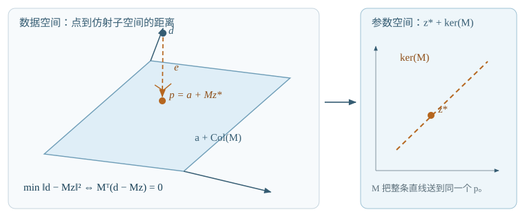

# 点到平面、两点与异面直线的最短距离

它们是同一个投影定理的三种实例，但不是三个可以不加区分地互换的问题：点到平面直接给出一条仿射直线，异面直线把两个动点化成一条仿射平面，最小二乘则把数据拟合化成列空间中的最近点。共同结构能统一求解；变量、可行集、参数唯一性和计算方式仍要各自说清。 ^p-claim

先把三个问题各自说完整。点到平面：给定点 $P$ 与仿射平面 $\pi$，找 $H\in\pi$，使 $\lVert P-H\rVert$ 最小。异面直线：给定 $l_1,l_2$，各取一点 $X,Y$，使 $\lVert X-Y\rVert$ 最小，并问最近的 $(X,Y)$ 是否唯一。最小二乘：给定 $A\in\mathbb R^{m\times n}$、$\mathbf b\in\mathbb R^m$，找 $\hat{\mathbf x}$，使 $\lVert\mathbf b-A\hat{\mathbf x}\rVert$ 最小，并区分拟合点与拟合系数是否唯一。三个目标都是距离最小，但前两个的输出是一个点或一对点，第三个首先输出的是数据空间里的拟合点，参数只是它的表示。 ^p-questions

> [!side] 相关信息 @p-questions
> **仿射子空间**是子空间的平移：$\mathbf a+U$。直线、平面、列空间都是。若 $U=\operatorname{Col}(M)$，这个集合可以统一写成
> $$S=\{\mathbf a+M\mathbf z:\mathbf z\in\mathbb R^n\}.$$
> 这里的 $\mathbf a$ 给位置，$M$ 的列给方向。

## 先把三个问题塞进同一个模型

点到平面取 $\mathbf a=\mathbf p_0$、$M=[\mathbf u\ \mathbf v]$，其中 $\mathbf u,\mathbf v$ 是平面内两个线性无关方向，$\mathbf c=P$。异面直线取 $l_1:\mathbf p_1+t\mathbf u$、$l_2:\mathbf p_2+s\mathbf v$，考察两点之差 ^p-model

$$\mathbf Y-\mathbf X=\underbrace{(\mathbf p_2-\mathbf p_1)}_{\mathbf c}-\underbrace{(t\mathbf u-s\mathbf v)}_{M\mathbf z},\qquad M=[\mathbf u\ -\mathbf v],\quad \mathbf z=\begin{bmatrix}t\\s\end{bmatrix}.$$

当 $t,s$ 取遍实数时，$M\mathbf z$ 扫过由 $\mathbf u,\mathbf v$ 张成的线性平面。因此两线距离等于 $\mathbf c$ 到这个平面的距离。两条线不平行时 $\mathbf u,\mathbf v$ 无关，$M$ 列满秩；平行时它们共线，集合降为仿射直线，距离仍可定义，但不能继续用 $\mathbf u\times\mathbf v$ 作非零法向量。

最小二乘把 $\mathbf a=\mathbf0$、$M=A$、$\mathbf c=\mathbf b$。讲义里的三个数据点 $(1,1),(2,2),(3,2)$ 合成 $\mathbf b=(1,2,2)^{\mathsf T}$，而

$$C(1,1,1)^{\mathsf T}+D(1,2,3)^{\mathsf T}=A\begin{bmatrix}C\\D\end{bmatrix},\qquad A=\begin{bmatrix}1&1\\1&2\\1&3\end{bmatrix}.$$

拟合直线不是到散点图里某条固定直线的距离，而是到三维数据空间中一张仿射平面的距离。这张平面经过原点，因为 $C=D=0$ 对应常数项与斜率同时为零。一般线性模型若有截距之外的固定偏移，就把 $\mathbf a$ 显式写出来。 ^p-ls

> [!xref] 知识链接 @p-ls
> 图、法方程与残差的完整计算见[[2.1-列空间中的最近点|第 2 章第 1 节　正交投影与最小二乘法]]。

> [!res] s.ocw-ses22-p2 @p-ls

所以统一问题是 ^p-unified

$$\min_{\mathbf z\in\mathbb R^n}\lVert\mathbf d-M\mathbf z\rVert^2,\qquad \mathbf d=\mathbf c-\mathbf a.$$

对应不是只找一个相似比喻：三个问题的可行方向都写成 $M\mathbf z$，距离都写成同一个二次函数，正交条件也都会变成 $M^{\mathsf T}(\mathbf d-M\mathbf z)=0$。图 1 同时画出数据空间的最近点与参数空间的核：核方向改变参数，却不改变输出。 ^p-unified

> [!figure] 图 1　统一投影模型：残差垂直于可行方向，参数可沿核方向移动而拟合点不变（本项目原创，MIT）
> 

## 最近为什么恰好垂直

统一模型仍然只是“说它们像”；接下来要证明“当且仅当”。设 $\mathbf z^*$ 是一个解，令 $\hat{\mathbf p}=\mathbf a+M\mathbf z^*$、$\mathbf e=\mathbf d-M\mathbf z^*$。任何其他可行点可写成 $\hat{\mathbf p}+M\mathbf h$，其中 $\mathbf h=\mathbf z-\mathbf z^*$。 ^p-proof

**充分性。** 若 $\mathbf e\perp\operatorname{Col}(M)$，则 $(M\mathbf h)^{\mathsf T}\mathbf e=0$。由内积展开，

$$\lVert\mathbf d-(\mathbf a+M\mathbf z)\rVert^2=\lVert\mathbf e-M\mathbf h\rVert^2=\lVert\mathbf e\rVert^2+\lVert M\mathbf h\rVert^2\ge\lVert\mathbf e\rVert^2.$$

等号成立当且仅当 $M\mathbf h=0$。因此 $\hat{\mathbf p}$ 是最近点；若再有 $\ker M=\{\mathbf0\}$，等号还迫使 $\mathbf h=0$，参数解唯一。

**必要性。** 若 $\mathbf z^*$ 最小化 $g(\mathbf z)=\lVert\mathbf d-M\mathbf z\rVert^2$，则它在 $\mathbf z^*$ 处可微，梯度必须为零：

$$\nabla g(\mathbf z^*)=-2M^{\mathsf T}(\mathbf d-M\mathbf z^*)=-2M^{\mathsf T}\mathbf e=0.$$

也可以不用微积分：固定任意 $\mathbf h$，比较 $\mathbf z^*$ 与 $\mathbf z^*+t\mathbf h$，得到

$$\lVert\mathbf e-tM\mathbf h\rVert^2\ge\lVert\mathbf e\rVert^2\quad\text{对任意 }t\in\mathbb R.$$

这是关于 $t$ 的非负二次函数，一次项必须为零，所以 $\mathbf e^{\mathsf T}M\mathbf h=0$。由 $\mathbf h$ 任意，$\mathbf e$ 垂直于整个列空间。证明到这里，才有资格写“最近 $\Leftrightarrow$ 残差垂直于列空间”。若只说勾股定理，证明的只是充分性。 ^p-iff

> [!res] s.note-2-1-orth @p-iff

法方程 $M^{\mathsf T}M\hat{\mathbf z}=M^{\mathsf T}\mathbf d$ 正是这个条件的坐标写法。这里“方程有解”不要求 $M^{\mathsf T}M$ 可逆；$M^{\mathsf T}\mathbf d$ 总在 $\operatorname{Col}(M^{\mathsf T})$ 中，所以至少有一组参数使残差落在 $\ker M^{\mathsf T}$。可逆性决定的是参数是否唯一，而不是最近点是否存在。

## 统一求解，也统一看四个子空间

令 $M^+$ 为 Moore–Penrose 伪逆。上面的正交分解给出不依赖具体题面的答案： ^p-solve

$$\boxed{\hat{\mathbf p}=\mathbf a+MM^+\mathbf d},\qquad \boxed{\mathbf e=(I-MM^+)\mathbf d},\qquad \boxed{d=\lVert(I-MM^+)\mathbf d\rVert}.$$

任取一个满足 $M^{\mathsf T}\mathbf e=0$ 的参数解 $\mathbf z_0$，全部参数解是 $\hat{\mathbf z}=\mathbf z_0+\ker M$；其中 $M^+\mathbf d$ 是欧氏长度最小的参数代表。若 $M$ 列满秩，$M^+=(M^{\mathsf T}M)^{-1}M^{\mathsf T}$，参数解唯一；若列亏，参数可以很多，但 $M\hat{\mathbf z}$ 与残差不变。

同一个分解同时看清四个基本子空间。设 $M\in\mathbb R^{m\times n}$，则 ^p-four

- 列空间 $\operatorname{Col}(M)$：数据空间中的可行方向，也是拟合点与 $\mathbf a$ 的差所在之处；
- 零空间 $\ker M$：不改变拟合点的参数方向，解集的“参数自由度”来自这里；
- 行空间 $\operatorname{Row}(M)$：与 $\ker M$ 正交，参数空间中真正影响输出的部分；
- 左零空间 $\ker M^{\mathsf T}$：数据空间中与所有可行方向正交的方向，残差 $\mathbf e$ 必在其中。

$\mathbb R^n=\ker M\oplus\operatorname{Row}(M)$，$\mathbb R^m=\operatorname{Col}(M)\oplus\ker M^{\mathsf T}$。这两个直和解释不是背出来的：第一个来自每个参数向量在 $\ker M$ 上的投影不改变输出；第二个说明残差把 $\mathbf d$ 中“拟合不到的部分”单独留下。异面直线平行时，$\ker M$ 变大，因此最近点对 $(X,Y)$ 不唯一，但差向量与距离仍唯一；最小二乘列亏时同理，唯一的是 $\hat{\mathbf p}$，不一定是 $\hat{\mathbf z}$。 ^p-unique

> [!res] s.l15-indep @p-unique

## 三个算例落在同一张纸上

**点到平面。** 取 $\pi:z=0$、$\mathbf a=\mathbf0$、$\mathbf c=(1,2,3)$，则 $M$ 可取 $\begin{bmatrix}1&0\\0&1\\0&0\end{bmatrix}$，$M^+\mathbf c=(1,2)^{\mathsf T}$，故 $\hat{\mathbf p}=(1,2,0)$、$\mathbf e=(0,0,3)$、$d=3$。这与用法向量 $(0,0,1)$ 算距离一致；法向量公式是这个模型在 $\ker M^{\mathsf T}$ 恰为一维时的快捷写法。

**异面直线。** 取 $l_1:t(1,1,0)$、$l_2:(1,0,0)+s(0,1,1)$。此时 $\mathbf c=(1,0,0)$、$M=[\mathbf u\ -\mathbf v]$，

$$M^{\mathsf T}M=\begin{bmatrix}2&-1\\-1&2\end{bmatrix},\qquad M^{\mathsf T}\mathbf c=\begin{bmatrix}1\\0\end{bmatrix},$$

解得 $t=\tfrac23,s=\tfrac13$。最近点为 $(\tfrac23,\tfrac23,0)$ 与 $(1,\tfrac13,\tfrac13)$，差为 $(\tfrac13,-\tfrac13,\tfrac13)$，距离 $\tfrac1{\sqrt3}$，方向正是 $\mathbf u\times\mathbf v=(1,-1,1)$。

**最小二乘。** 对上面的 $A$，$\mathbf n=(1,1,1)\times(1,2,3)=(1,-2,1)$，故

$$\mathbf e=\frac{\mathbf b^{\mathsf T}\mathbf n}{\mathbf n^{\mathsf T}\mathbf n}\mathbf n=\frac1{6}(1,-2,1),\qquad d=\frac1{\sqrt6}.$$

讲义解 $A^{\mathsf T}A\hat{\mathbf x}=A^{\mathsf T}\mathbf b$ 得同一残差。散点图上的三条竖直残差，是这根三维垂线的三个分量；它们不垂直于拟合出的散点直线。 ^p-calc

> [!res] s.l15-normal @p-calc

## 相同结构不等于相同算法

法方程与法向量公式都能用，但不能说“哪边维数少就选哪边”。法方程把条件数平方：若 $M$ 的最小、最大奇异值为 $\sigma_{\min},\sigma_{\max}$，则 $M^{\mathsf T}M$ 的条件数为 $(\sigma_{\max}/\sigma_{\min})^2$。列近相关时，直接形成法方程会放大舍入误差；QR 或 SVD 通常更稳。矩阵很小、结构特殊或需要精确闭式表达时，法方程也可能完全合适。算法选择还取决于稀疏性、数据规模、约束、所需精度与实现成本。 ^p-stability

统一公式也有边界，这些边界不摧毁共同结构，只说明下一步要换模型。 ^p-boundary

**加权。** 若各观测的可信度不同，可定义 $\langle\mathbf u,\mathbf v\rangle_W=\mathbf u^{\mathsf T}W\mathbf v$。它要成为内积，必须 $W$ 对称正定；正定保证非零向量的自内积严格大于零。此时垂直条件写成 $M^{\mathsf T}W(\mathbf d-M\mathbf z)=0$，伪逆也要在 $W$ 诱导的范数下理解。仅把数字乘进残差、却不检查正定性，不足以建立同样的勾股证明。

**范数改变。** 取各坐标差绝对值之和，求 $(1,1)$ 到直线 $x+y=0$ 的距离：直线上点为 $(s,-s)$，距离为 $|1-s|+|1+s|$，在 $-1\le s\le1$ 时恒为 2。最近点有一整段。问题仍有解，但“最近 $\Leftrightarrow$ 垂直”失效，因为勾股定理不再适用。

**集合变弯。** 圆外一点到圆，连线垂直于切线的点有最近点与最远点两个。垂直仍可能是候选条件，却不是充分条件；还要比较函数值或检查局部二阶变化。对光滑流形，切空间中的投影给出局部一阶条件，不能直接代替全局最近点。

**函数空间。** 若指定内积 $\langle f,g\rangle=\int_a^b f(x)g(x)\,dx$，且给定区间、正交或需正交化的基函数，那么在闭线性张成空间中，正交条件确实给出最小二乘逼近。傅里叶系数还必须带相应的积分与归一化（非归一化正弦、余弦基要除以基函数范数平方）；只说“内积换成积分”还不够。无限维空间中，先要保证相应子空间闭，或确认目标存在正交投影，不能从有限维证明直接照搬。

**非线性。** 若可行点由 $\phi(\mathbf z)$ 给出，Gauss–Newton 是在当前 $\mathbf z_k$ 附近用 $\phi(\mathbf z_k)+D\phi(\mathbf z_k)\Delta\mathbf z$ 代替曲线，再解一个线性最小二乘子问题。它把本题的投影定理用作局部工具，并不保证一次求解就得到全局最近点。 ^p-gn

## 把定理变成下一次能用的动作

下次遇到“同时让几个距离最小”，先不要找共同口号，按四步走： ^p-move

1. 把每个问题的对象、变量、条件和目标各写一遍，确认要最小化的是同一个量，还是只是名字都叫“距离”。
2. 把可行方向写成 $M\mathbf z$。若两个动点的差能化成“给定点减一个线性组合”，就尝试化成点到仿射子空间。
3. 先证正交条件的两个方向，再分别回答：哪个量唯一、哪个参数不唯一、哪个条件失效。
4. 选算法时检查条件数与数值稳定性，不只看矩阵大小；把新得到的结构接回已有讲义或关系，而不是让它停在一次漂亮的类比。

沿差向量还可继续走：两个仿射子空间的差仍是仿射子空间，$S_1-S_2=(\mathbf a_1-\mathbf a_2)+(\operatorname{Col}M_1+\operatorname{Col}M_2)$。但要小心：最近的一对点通常不唯一，唯一的首先是它们之差；若还要指定“各自离某个原点最近”，就加入了额外目标，不能混为一谈。 ^p-next

两个平行平面之间，最近点对为什么不唯一，而两平面之间的距离只有一个？用四个子空间的分解写出你的理由。

```vein-graph
{"nodes":[
{"id":"ls","label":"最小二乘","kind":"item","layer":0,"ref":"n.least-squares"},
{"id":"pp","label":"点到平面的距离","kind":"item","layer":0,"ref":"n.point-plane"},
{"id":"sk","label":"异面直线的距离","kind":"item","layer":0,"ref":"n.skew-lines"},
{"id":"affine","label":"仿射子空间","kind":"concept","layer":1,"ref":"n.affine-set"},
{"id":"proj","label":"统一投影模型","kind":"core","layer":2},
{"id":"orth","label":"正交条件","kind":"concept","layer":3,"ref":"n.orthogonality"},
{"id":"pinv","label":"Moore–Penrose 伪逆","kind":"concept","layer":3,"ref":"n.normal-eq"},
{"id":"col","label":"列空间","kind":"concept","layer":1,"ref":"n.colspace"},
{"id":"null","label":"零空间","kind":"concept","layer":1,"ref":"n.nullspace"},
{"id":"row","label":"行空间","kind":"concept","layer":1},
{"id":"left","label":"左零空间","kind":"concept","layer":1},
{"id":"pointuniq","label":"拟合点唯一","kind":"concept","layer":4,"ref":"n.unique-solution"},
{"id":"paramuniq","label":"参数唯一","kind":"concept","layer":4},
{"id":"rank","label":"列满秩","kind":"concept","layer":5,"ref":"n.full-column-rank"},
{"id":"normal","label":"法方程","kind":"concept","layer":3,"ref":"n.normal-eq"},
{"id":"weight","label":"加权内积","kind":"idea","layer":2},
{"id":"stable","label":"QR / SVD 数值稳定性","kind":"idea","layer":2},
{"id":"l1","label":"绝对值范数","kind":"idea","layer":2},
{"id":"circle","label":"弯曲集合","kind":"idea","layer":2},
{"id":"fourier","label":"傅里叶系数","kind":"idea","layer":2},
{"id":"gauss","label":"Gauss–Newton 局部线性化","kind":"idea","layer":2},
{"id":"diffset","label":"两仿射集之差","kind":"idea","layer":2}
],"edges":[
{"id":"e-sk-model","from":"sk","to":"affine","type":"generalizes","label":"两点之差化为点到平面","explanation":"两直线上两点之差是 c − (tu − sv)，参数扫过 u、v 的张成空间，因此两线距离是点 c 到仿射平面的距离。","assumptions":["u、v 是直线方向向量"],"epistemic":"logically-derived"},
{"id":"e-ls-model","from":"ls","to":"affine","type":"generalizes","label":"数据空间中的列空间","explanation":"所有拟合值 A z 扫过 Col(A)，最小二乘就是求 b 到这张仿射平面的最近点。","assumptions":["A 为实矩阵","b 与 A 的列同维"],"epistemic":"source-backed","sources":["notes/2.1-列空间中的最近点.md#从代数问题到几何问题"]},
{"id":"e-pp-model","from":"pp","to":"affine","type":"generalizes","label":"平面就是仿射集","explanation":"平面可写为 a + Col(M)，点到平面的最近点属于同一个投影模型。","assumptions":["欧氏内积"],"epistemic":"logically-derived"},
{"id":"e-affine-proj","from":"affine","to":"proj","type":"derives-from","label":"方向写成 Mz","explanation":"令 S = a + Col(M)、d = c − a，三个问题都化为最小化 ‖d − Mz‖²。","assumptions":["方向空间有限维"],"epistemic":"logically-derived"},
{"id":"e-proj-orth","from":"proj","to":"orth","type":"equivalent-under","label":"最近 ⇔ 残差正交","explanation":"充分性由 e 与 Mh 正交时的勾股展开得到；必要性由任意一维变分的二次函数一次项为零得到。","assumptions":["距离来自内积","S 为仿射子空间"],"epistemic":"source-backed","sources":["notes/2.1-列空间中的最近点.md#最近点满足的条件"]},
{"id":"e-orth-normal","from":"orth","to":"normal","type":"derives-from","label":"正交条件坐标化","explanation":"残差与 M 的每列正交即 Mᵀ(d − Mz) = 0，整理得到法方程 MᵀMz = Mᵀd。","assumptions":["实矩阵","标准内积"],"epistemic":"logically-derived"},
{"id":"e-proj-pinv","from":"proj","to":"pinv","type":"derives-from","label":"统一解与残差公式","explanation":"正交分解给出 p̂ = a + MM⁺d，残差 e = (I − MM⁺)d，距离为其余下范数。","assumptions":["M⁺ 是 Moore–Penrose 伪逆"],"epistemic":"logically-derived"},
{"id":"e-proj-col","from":"proj","to":"col","type":"defined-by","label":"可行方向","explanation":"M z 的全部取值组成列空间，最近点与 a 的差必须落在这个空间里。","assumptions":["z 取遍参数空间"],"epistemic":"logically-derived"},
{"id":"e-col-left","from":"col","to":"left","type":"equivalent-under","label":"正交补","explanation":"左零空间 ker Mᵀ 是列空间在数据空间中的正交补，残差必在其中。","assumptions":["欧氏内积"],"epistemic":"logically-derived"},
{"id":"e-null-row","from":"null","to":"row","type":"equivalent-under","label":"参数空间正交补","explanation":"行空间是 ker M 的正交补，参数变化中真正改变输出的部分落在行空间。","assumptions":["欧氏内积"],"epistemic":"logically-derived"},
{"id":"e-null-param","from":"null","to":"paramuniq","type":"derives-from","label":"参数解集 = 特解 + 核","explanation":"同一拟合点的两个参数之差落在 ker M，因此参数不唯一的充要条件是 M 有非零零空间。","assumptions":["已存在一个最小二乘解"],"epistemic":"logically-derived"},
{"id":"e-rank-null","from":"rank","to":"null","type":"equivalent-under","label":"满秩 ⇔ 核只有零","explanation":"M 列满秩当且仅当 ker M = {0}，也就是列向量线性无关，没有非零参数被压成零。","assumptions":["M 为实矩阵"],"epistemic":"logically-derived"},
{"id":"e-rank-param","from":"rank","to":"paramuniq","type":"equivalent-under","label":"列满秩才有唯一参数","explanation":"M 列满秩当且仅当 ker M = {0}，此时法方程参数解唯一；列亏时参数有无穷多组。","assumptions":["M 为实矩阵"],"epistemic":"source-backed","sources":["notes/2.1-列空间中的最近点.md#点唯一，参数未必唯一"]},
{"id":"e-normal-pinv","from":"normal","to":"pinv","type":"derives-from","label":"从法方程到统一解","explanation":"法方程刻画全部最小二乘参数解；Moore–Penrose 伪逆从中选出最小范数代表，并给出唯一拟合点与残差公式。","assumptions":["M⁺ 是 Moore–Penrose 伪逆"],"epistemic":"logically-derived"},
{"id":"e-proj-point","from":"proj","to":"pointuniq","type":"derives-from","label":"投影定理保证拟合点唯一","explanation":"两个最近点的差都落在 Col(M)，同时又落在 ker Mᵀ；两个空间正交，因此这个差只能为零。","assumptions":["欧氏内积","S 为仿射子空间"],"epistemic":"logically-derived"},
{"id":"e-param-point","from":"paramuniq","to":"pointuniq","type":"contrasts-with","label":"参数唯一 ≠ 点的唯一","explanation":"即使参数有无穷多组，所有参数经 M 作用后仍给出同一个拟合点，残差与距离也唯一。","assumptions":["参数解已满足法方程"],"epistemic":"logically-derived"},
{"id":"e-normal-stable","from":"normal","to":"stable","type":"contrasts-with","label":"闭式方便与数值稳定要分开","explanation":"法方程把条件数平方，列近相关时 QR 或 SVD 往往更稳；算法选择不只取决于两侧维数。","assumptions":["MᵀM 的条件数为原矩阵条件数平方"],"epistemic":"logically-derived"},
{"id":"e-weight-proj","from":"weight","to":"proj","type":"generalizes","label":"换内积，不换投影结构","explanation":"W 对称正定时，加权垂直条件为 MᵀW(d − Mz) = 0，仍由勾股展开证明。","assumptions":["W 对称正定"],"epistemic":"logically-derived","boundary":"W 非正定时不能据此定义内积"},
{"id":"e-l1-orth","from":"l1","to":"orth","type":"counterexample-to","label":"勾股展开失效","explanation":"绝对值之和不来自内积，点 (1,1) 到 x + y = 0 的最近点是一整段而非唯一垂足。","assumptions":["距离取坐标绝对差之和"],"epistemic":"logically-derived","boundary":"改变的是范数，不改变仿射集合"},
{"id":"e-circle-orth","from":"circle","to":"orth","type":"counterexample-to","label":"垂直不保证最小","explanation":"圆外点到圆的最近点与最远点都垂直于切线，垂直只给出局部候选，不能单独判定全局最小。","assumptions":["集合为圆"],"epistemic":"logically-derived"},
{"id":"e-fourier-proj","from":"fourier","to":"proj","type":"generalizes","label":"指定内积后的函数投影","explanation":"在给定区间与基函数下，最小二乘逼近的正交条件给出带归一化的傅里叶系数。","assumptions":["平方可积函数空间","指定区间、内积与基函数"],"epistemic":"pedagogical-inference","boundary":"无限维情形需检查闭包与投影存在性"},
{"id":"e-gauss-proj","from":"gauss","to":"proj","type":"applies-to","label":"局部线性子问题","explanation":"Gauss–Newton 用当前点的切线性模型替代非线性模型，每一步解一个线性最小二乘问题。","assumptions":["非线性映射可微","只保证局部模型"],"epistemic":"logically-derived","boundary":"不保证全局收敛或一次得到全局最近点"},
{"id":"e-diffset","from":"diffset","to":"affine","type":"generalizes","label":"差仍是仿射子空间","explanation":"S₁ − S₂ = (a₁ − a₂) + (Col M₁ + Col M₂)，可用于两个动点的距离问题。","assumptions":["两个集合均为仿射子空间"],"epistemic":"logically-derived","boundary":"最近点对通常不唯一，唯一的首先是差向量"}
]}
```
