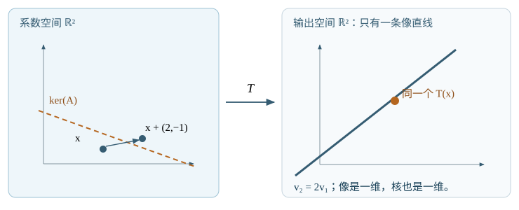
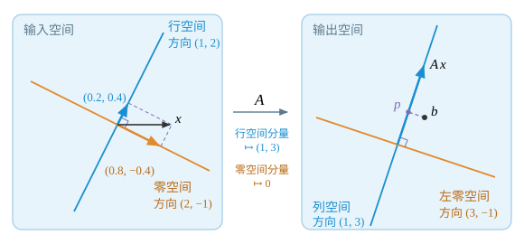
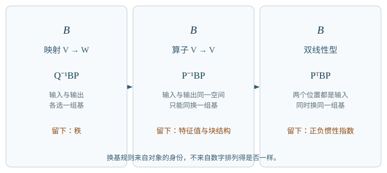

# 线性代数的对象、运算与结构

线性代数只认一种运算：线性组合，也就是相加与数乘。它研究的是能做线性组合的东西，以及尊重这种运算的对象。对象有四类：空间本身；从一个空间到另一个空间的映射；从一个空间到它自己的算子；给两个向量打一个分数的双线性型。 ^p-intro

对每一类对象，课程做的是同样三件事。**生成**：用尽量少的几样东西把它造出来，并清点其中的冗余。**表示**：选一组基，把它记成一张数表。**分类**：换一组基，数表变了，哪些量没变；能把它化到多简单。课本的各章是这张“对象 × 动作”表里的格子。同一张 $2\times2$ 的数表，放进不同的格子，是不同的东西。

读的时候请分清四种联系，它们的证据强度不同。**依赖**：后者的定义或证明用到前者。**等价**：同一件事的两种说法，附带成立的条件。**推广**：前者是后者的特例。**动机**：前者的局限让人提出后者，但后者不由前者推出。把动机当成依赖，会以为先讲的是后讲的前提。 ^p-links

> [!res] 课程 @p-intro
> [MIT 18.06 线性代数（Gilbert Strang）](https://ocw.mit.edu/courses/18-06-linear-algebra-spring-2010/)
> 全部录像与讲义

> [!side] 相关信息 @p-links
> 为什么单单研究线性的东西？可微的映射在一点附近，增量近似于一个线性映射作用在位移上：$f(\mathbf x+\mathbf h)\approx f(\mathbf x)+Df(\mathbf x)\,\mathbf h$。这个线性映射 $Df(\mathbf x)$ 就是导数。非线性的问题，局部都要先回到线性的问题上。

## 一组向量就是一个映射

拿两个向量 $\mathbf v_1=(1,3)$，$\mathbf v_2=(2,6)$。对一组向量只能做一件事：线性组合 $a_1\mathbf v_1+a_2\mathbf v_2$。于是只有两个问题可问。组合能到达哪些地方？到达同一个地方的办法是否唯一？前一个问的是生成，后一个问的是冗余。 ^p-list

这里 $\mathbf v_2=2\mathbf v_1$，所有组合都落在 $(1,3)$ 方向的直线上，平面的大部分到不了。同时 $2\mathbf v_1-\mathbf v_2=\mathbf 0$，所以系数 $(a_1,a_2)$ 加上 $(2,-1)$ 的任意倍数，组合的结果不变，办法不唯一。

把“取系数、做组合”这件事本身看成一个映射：

$$T:\ (a_1,a_2)\ \longmapsto\ a_1\mathbf v_1+a_2\mathbf v_2=\begin{bmatrix}1&2\\3&6\end{bmatrix}\begin{bmatrix}a_1\\a_2\end{bmatrix}.$$

它是线性的，它的数表正是把这组向量排成列得到的矩阵 $A=\begin{bmatrix}1&2\\3&6\end{bmatrix}$。关于向量组的每一个概念，都是关于 $T$ 的一个概念。图 1 把这件事画成两个空间之间的映射：系数沿核方向移动，输出却停在同一个点。 ^p-hinge

> [!figure] 图 1　向量组就是映射：相差一个核向量的两个系数给出同一个输出（本项目原创，MIT）
> 

> [!table] 表 1　向量组的问题与映射的问题逐条对应
> | 关于向量组 $\mathbf v_1,\dots,\mathbf v_k$ | 关于映射 $T:\mathbb R^k\to V$ | 例中的答案 |
> | --- | --- | --- |
> | 张成的集合 | $T$ 的像 | $(1,3)$ 方向的直线 |
> | 能否生成整个空间 | $T$ 是否满射 | 否 |
> | 是否线性无关 | $T$ 是否单射，即核里只有 $\mathbf 0$ | 否，核是 $(2,-1)$ 方向的直线 |
> | 是不是一组基 | $T$ 是否可逆 | 否 |
> | $\mathbf b$ 能否被线性表出 | 方程 $T\mathbf a=\mathbf b$ 是否有解 | 当且仅当 $\mathbf b$ 在那条直线上 |

这是一条**等价**，两边是同一件事的两种说法。“向量组”与“线性方程组”两章因此是同一章：$A\mathbf x=\mathbf b$ 问的是 $\mathbf b$ 是不是各列的组合。有解时，全部解是一个特解加上核里的任意向量，因为核里的向量改变系数而不改变结果。

**基**是既能生成、又无冗余的一组向量。按表 1 的第四行，一组基就是一个可逆的线性映射 $\mathbb R^n\to V$：它给 $V$ 里每个向量一组唯一的坐标。“表示”这个动作从这里开始，之后的一切数表都以选定的基为前提。 ^p-basis

一个空间有许多组基。定理说，线性无关的一组向量，个数不会超过能生成全空间的一组向量。所以任何两组基的个数相同，这个数叫**维数**。维数是三个动作第一次走完一遍：对象是空间，换基之后不变的量是维数，而且它是**完全**的不变量——同一个数域上两个有限维空间，维数相同就可以互相当作同一个空间，最简的样子是 $\mathbb R^n$。

有了维数就能清点。对任何线性映射，

$$\dim(\text{输入空间})=\dim(\text{核})+\dim(\text{像}).$$

例中是 $2=1+1$。意思是：输入的每一个自由度，要么被映射抹掉，要么在输出里留下来，没有第三种去处。输入与输出维数相同时（方阵的情形），由这次清点得到：单射、满射、可逆三件事同时成立或同时不成立。长方的矩阵没有这个结论。 ^p-count

> [!side] 相关信息 @p-count
> 这次清点的正式名称是秩–零化度定理。更细的说法：相差一个核向量的两个输入，映射分辨不出。把分辨不出的输入并成一类，这些类组成商空间 $\mathbb R^n/\operatorname{Nul}(A)$，映射在它上面与像一一对应。

## 列在生成，行在测量

矩阵有两种读法。按列读，$A\mathbf x$ 是各列以 $\mathbf x$ 的分量为系数的组合，列在**生成**输出。按行读，每一行与 $\mathbf x$ 相乘得到一个数，行在**测量**输入。$A=\begin{bmatrix}1&2\\3&6\end{bmatrix}$ 对 $\mathbf x$ 做了两次测量：$x_1+2x_2$ 与 $3x_1+6x_2$。第二次是第一次的三倍，没有带来新信息。 ^p-rows

转置把两种读法对调：$A^{\mathsf T}$ 的列是 $A$ 的行。对 $A$ 和 $A^{\mathsf T}$ 各问一次“像是什么、核是什么”，得到四个子空间。

- **列空间**，$A$ 的像：输出里到得了的地方。例中是 $(1,3)$ 方向的直线。
- **零空间**，$A$ 的核：每一次测量的读数都是零的输入。例中是 $(2,-1)$ 方向的直线。
- **行空间**，$A^{\mathsf T}$ 的像：各次测量张成的空间。例中是 $(1,2)$ 方向的直线。
- **左零空间**，$A^{\mathsf T}$ 的核：满足 $\mathbf y^{\mathsf T}A=\mathbf 0$ 的 $\mathbf y$。例中是 $(3,-1)$ 方向的直线。

左零空间是输出一侧的测量。取 $\mathbf y=(3,-1)$。若 $A\mathbf x=\mathbf b$ 有解，两边左乘 $\mathbf y^{\mathsf T}$ 得 $\mathbf y^{\mathsf T}\mathbf b=\mathbf y^{\mathsf T}A\mathbf x=0$，即 $3b_1-b_2=0$。$\mathbf b=(1,3)$ 通过这次检验，有解。$\mathbf b=(1,1)$ 的读数是 $2$，无解，而且这一个数就是无解的证明，不必消元。反过来也对：通过左零空间里全部检验的 $\mathbf b$ 一定有解。 ^p-cert

**行秩等于列秩**　$A$ 的每一列都是 $(1,3)$ 的倍数，所以 $A=\begin{bmatrix}1\\3\end{bmatrix}\begin{bmatrix}1&2\end{bmatrix}$。一般地，取 $r$ 个线性无关的列排成 $C$，把其余各列用它们表出，得到 $A=CR$，$R$ 只有 $r$ 行。这个式子按行读，$A$ 的每一行都是 $R$ 的 $r$ 行的组合，所以行秩不超过列秩。对 $A^{\mathsf T}$ 再做一遍，得到相反的不等式。独立的生成元有几个，独立的测量就有几个，这个共同的数是**秩**。 ^p-rank

> [!figure] 图 2　$A=\begin{bmatrix}1&2\\3&6\end{bmatrix}$ 的四个子空间。输入 $\mathbf x=(1,0)$ 拆成行空间里的一份和零空间里的一份（本项目原创，MIT）
> 

图 2 把四条直线画了出来。左边，$\mathbf x=(1,0)=(0.2,\,0.4)+(0.8,\,-0.4)$：后一份在零空间里，被 $A$ 抹掉；前一份在行空间里，被送到 $(1,3)$。$A$ 限制在行空间上是一一对应，对面是列空间，两边都是 $r$ 维。四个子空间的维数分别是 $r$、$n-r$、$r$、$m-r$，上一节的清点在输入、输出两侧各做了一次。 ^p-four

四个子空间的定义只用到线性组合。图上的两个直角则多用了一样东西：把“这一行测得零”画成“与这一行垂直”，用的是点积。垂直是下一节的内容。

> [!res] 视频 @p-four
> [MIT 18.06 第 10 讲：四个基本子空间](https://ocw.mit.edu/courses/18-06-linear-algebra-spring-2010/resources/lecture-10-the-four-fundamental-subspaces/)
> 四个子空间的维数与基

## 给空间一把尺子

到这里为止，向量没有长度，两个向量之间没有夹角。$\mathbf b=(1,1)$ 时方程无解，这件事已经说完了。再问“那么离 $\mathbf b$ 最近的、到得了的点是哪个”，是一个新问题。这是一条**动机**：无解让人想问最近，但“最近”不由消元推出，它**依赖**一样新的结构。 ^p-ruler

这样新结构是**内积**：给两个向量打分的一条规则 $\langle\mathbf x,\mathbf y\rangle$，对两个位置都线性、对称，并且 $\langle\mathbf x,\mathbf x\rangle>0$（$\mathbf x\neq\mathbf 0$）。它是第四类对象里被选中的一个，相当于给空间配了一把尺子：长度是 $\sqrt{\langle\mathbf x,\mathbf x\rangle}$，垂直是 $\langle\mathbf x,\mathbf y\rangle=0$。以下用点积 $\langle\mathbf x,\mathbf y\rangle=\mathbf x^{\mathsf T}\mathbf y$。

有了尺子，转置多了一层含义：

$$\langle A\mathbf x,\mathbf y\rangle=(A\mathbf x)^{\mathsf T}\mathbf y=\mathbf x^{\mathsf T}(A^{\mathsf T}\mathbf y)=\langle\mathbf x,A^{\mathsf T}\mathbf y\rangle.$$

由它直接读出图 2 的两个直角。$\mathbf y$ 与列空间垂直，即对一切 $\mathbf x$ 有 $\langle A\mathbf x,\mathbf y\rangle=0$，即对一切 $\mathbf x$ 有 $\langle\mathbf x,A^{\mathsf T}\mathbf y\rangle=0$，即 $A^{\mathsf T}\mathbf y=\mathbf 0$。所以左零空间恰是列空间的正交补。同理，零空间恰是行空间的正交补。 ^p-adj

回到最近点。列空间里离 $\mathbf b$ 最近的点 $\mathbf p=A\hat{\mathbf x}$，以误差 $\mathbf b-\mathbf p$ 垂直于列空间为特征。按刚才的结论，这就是 $A^{\mathsf T}(\mathbf b-A\hat{\mathbf x})=\mathbf 0$，即**法方程** $A^{\mathsf T}A\,\hat{\mathbf x}=A^{\mathsf T}\mathbf b$。对 $\mathbf b=(1,1)$：

$$\begin{bmatrix}10&20\\20&40\end{bmatrix}\hat{\mathbf x}=\begin{bmatrix}4\\8\end{bmatrix}\quad\Longrightarrow\quad \hat x_1+2\hat x_2=0.4,\qquad \mathbf p=A\hat{\mathbf x}=(0.4,\,1.2).$$

误差 $\mathbf b-\mathbf p=(0.6,-0.2)$，正是 $(3,-1)$ 的倍数，落在左零空间里。图 2 右半边画了这一步。 ^p-near

法方程的解有一整条直线，因为 $A^{\mathsf T}A$ 不可逆。它什么时候可逆，有一条完整的推理：若 $A^{\mathsf T}A\mathbf x=\mathbf 0$，则 $\mathbf x^{\mathsf T}A^{\mathsf T}A\mathbf x=\lVert A\mathbf x\rVert^2=0$，于是 $A\mathbf x=\mathbf 0$。所以 $A^{\mathsf T}A$ 与 $A$ 的零空间相同，秩也相同。同一个式子说明 $\mathbf x^{\mathsf T}(A^{\mathsf T}A)\mathbf x\ge 0$ 恒成立，等号只在 $\mathbf x=\mathbf 0$ 时取到，当且仅当 $A$ 的各列线性无关；这时 $A^{\mathsf T}A$ 可逆，最小二乘解唯一。 ^p-gram

各列相关时，解不唯一，但所有解给出同一个 $\mathbf p$。其中最短的一个落在行空间里：令 $\hat{\mathbf x}=t(1,2)$，代入得 $t=0.08$，$\hat{\mathbf x}=(0.08,\,0.16)$。这个“最小二乘解里长度最小的那一个”存在且唯一，把 $\mathbf b$ 送到它的规则叫**伪逆** $A^{+}$。

用尺子挑出来的好基是**标准正交基**：两两垂直，长度为一。从一组标准正交基换到另一组，换基矩阵 $Q$ 满足 $Q^{\mathsf T}Q=I$，叫正交矩阵。任何一组基都可以逐个减去在前面各向量上的投影，改造成标准正交基。

> [!xref] 知识链接 @p-near
> 最近点与垂直条件的完整推导见 [[2.1-列空间中的最近点|第 2 章第 1 节　正交投影与最小二乘法]]。

> [!res] s.l15-normal @p-gram

> [!side] 相关信息 @p-ruler
> 长度不一定来自内积。用各分量绝对值之和当长度也满足长度的基本要求，但它没有“垂直”可言，最近点也可能不止一个。最小二乘用的是由内积给出的长度，垂直条件才成立。

## 同一张数表，三样东西

数表 $B=\begin{bmatrix}2&1\\1&2\end{bmatrix}$ 记的是什么，要看换基时它怎样变。图 3 先比较三种对象允许怎样换基；下一步的行列式与不变量，才会随这些规则不同而留下不同信息。 ^p-three

> [!figure] 图 3　同一张数表的三种身份：映射、算子与双线性型使用不同的换基规则（本项目原创，MIT）
> 

- 记的是**映射** $V\to W$：输入、输出是两个空间，各换各的基，数表变成 $Q^{-1}BP$。
- 记的是**算子** $V\to V$：输入、输出是同一个空间，只有一组基可换，数表变成 $P^{-1}BP$。
- 记的是**双线性型** $\mathbf x^{\mathsf T}B\mathbf y$：两个位置都是输入，换基后数表变成 $P^{\mathsf T}BP$。

用行列式试一下。$\det B=3$。当作映射，$\det(Q^{-1}BP)$ 可以是任何非零的数，留下来的只有“非零”二字，即满秩。当作双线性型，$\det(P^{\mathsf T}BP)=(\det P)^2\cdot 3$，留下来的只有正负号。当作算子，$\det(P^{-1}BP)=3$，数值原样留下：它是面积被放大的倍数，更准确地说 $\lvert\det\rvert$ 是倍数，正负号记录定向有没有翻转。“行列式是什么”有三个答案，因为问的是三种对象。 ^p-det

课本里的相抵、相似、合同是三种等价关系，原因在此。三处的思路是同一个：定下对象，定下允许的换基，被换基连起来的数表算作同一个；然后找换基时不变的量，再找最简单的代表。

> [!table] 表 2　对象、允许的换基、完全不变量与最简形
> | 对象 | 允许的换基 | 完全决定它的量 | 最简形 |
> | --- | --- | --- | --- |
> | 空间 | 任意 | 维数 | $\mathbb R^n$ |
> | 映射 $V\to W$ | 两边各换各的（相抵 $Q^{-1}AP$） | 秩 | 左上角是 $I_r$，其余为零 |
> | 算子 $V\to V$ | 一组基，两边同换（相似 $P^{-1}AP$） | 复数域上：若尔当块的构成 | 若尔当形；可对角化时是对角形 |
> | 实对称双线性型 | 一组基（合同 $P^{\mathsf T}AP$） | 正、负惯性指数 | 对角线上是 $1$、$-1$、$0$ |
> | 有尺子的映射 | 两边各换，只许标准正交基（$U^{\mathsf T}AV$） | 全部奇异值 | 对角线上是奇异值 |
> | 有尺子的对称算子 | 只许标准正交基（$Q^{\mathsf T}AQ$） | 全部特征值，计重数 | 对角形 |

**不变量与完全不变量是两回事**　$I=\begin{bmatrix}1&0\\0&1\end{bmatrix}$ 与 $J=\begin{bmatrix}1&1\\0&1\end{bmatrix}$ 的特征值都是 $1,1$，行列式、迹、特征多项式全都相同。它们却不相似：$P^{-1}IP$ 永远是 $I$。区别在于 $I$ 有两个独立的特征方向，$J$ 只有一个。特征值是相似的不变量，但不完全；要把算子分清，得看若尔当块。若尔当形还有一个前提：特征多项式能分解成一次因式。复数域上总能，实数域上不一定。 ^p-complete

**“换法越少，留下越多”只在有包含关系时成立**　只许用标准正交基，是各换各的一种特例，所以奇异值比秩细：秩是非零奇异值的个数。相似也是相抵的特例，所以相似的矩阵秩相同。但相似与“只许标准正交基的各换各”互不包含。$\begin{bmatrix}1&1\\0&2\end{bmatrix}$ 与 $\begin{bmatrix}1&0\\0&2\end{bmatrix}$ 相似，奇异值不同；$\begin{bmatrix}1&0\\0&2\end{bmatrix}$ 与 $\begin{bmatrix}0&1\\2&0\end{bmatrix}$ 奇异值相同，特征值一个是 $1,2$，一个是 $\pm\sqrt2$。特征值与奇异值谁也不比谁细。

**最简形就是一次拆分**　表 2 每一行的最简形，都在说空间可以拆成几块，对象在每一块上是平凡的。秩标准形：输入拆成核与一个补空间，输出拆成像与一个补空间，映射在补空间与像之间是一一对应。对角形：空间拆成若干特征方向，算子在每个方向上只是乘一个数。惯性指数：空间拆成型取正、取负、取零的三块。“把矩阵分解”与“把矩阵分类”是同一个定理读了两遍。 ^p-split

**有尺子的两行**　$P$ 是正交矩阵时 $P^{-1}=P^{\mathsf T}$，相似与合同变成同一个变换。**谱定理**说实对称矩阵可以用正交矩阵对角化。$B$ 的特征值是 $3$ 与 $1$，特征方向是 $(1,1)$ 与 $(1,-1)$，互相垂直。同一次换基 $u=\tfrac{x+y}{\sqrt2}$，$v=\tfrac{x-y}{\sqrt2}$，既把算子化成两个方向上的伸缩，又把二次型 $\mathbf x^{\mathsf T}B\mathbf x$（双线性型在两个位置填同一个向量）化成平方和：

$$2x^2+2xy+2y^2=3u^2+v^2.$$

二次型给向量打的分可以是负数或零，例如 $x^2-y^2$，所以它一般不是“大小”。恒为正的那一种才量得出大小，它正是一把尺子。上一节的内积，是这张表第四行里正惯性指数取满的那个成员。 ^p-spec

**奇异值分解**是“有尺子的映射”那一行的定理：对任何 $m\times n$ 的实矩阵 $A$，秩为 $r$，输入空间有一组标准正交基 $\mathbf v_1,\dots,\mathbf v_n$，输出空间有一组标准正交基 $\mathbf u_1,\dots,\mathbf u_m$，使得 $A\mathbf v_i=\sigma_i\mathbf u_i$（$i\le r$，$\sigma_i>0$），$A\mathbf v_i=\mathbf 0$（$i>r$）。它**依赖**前面两样：$A^{\mathsf T}A$ 对称且 $\mathbf x^{\mathsf T}A^{\mathsf T}A\mathbf x\ge0$，谱定理给出它的一组标准正交特征向量，这就是 $\mathbf v_i$，对应的特征值记作 $\sigma_i^2$；再令 $\mathbf u_i=A\mathbf v_i/\sigma_i$（$i\le r$），其余的 $\mathbf u_i$ 补成标准正交基。 ^p-svd

它把图 2 细化了一层。$\mathbf v_1,\dots,\mathbf v_r$ 是行空间的基，其余的 $\mathbf v_i$ 是零空间的基；$\mathbf u_1,\dots,\mathbf u_r$ 是列空间的基，其余的是左零空间的基。对 $A=\begin{bmatrix}1&2\\3&6\end{bmatrix}$：$\mathbf v_1=\tfrac{1}{\sqrt5}(1,2)$，$\mathbf u_1=\tfrac{1}{\sqrt{10}}(1,3)$，$\sigma_1=\sqrt{50}$，$\mathbf v_2=\tfrac{1}{\sqrt5}(2,-1)$，$\mathbf u_2=\tfrac{1}{\sqrt{10}}(3,-1)$。伪逆沿着同一对方向倒着走，除以 $\sigma_1$：$A^{+}\mathbf b=\tfrac{\langle\mathbf u_1,\mathbf b\rangle}{\sigma_1}\mathbf v_1$。代入 $\mathbf b=(1,1)$ 得 $(0.08,\,0.16)$，与上一节一致。

> [!res] 视频 @p-svd
> [MIT 18.06 第 29 讲：奇异值分解](https://ocw.mit.edu/courses/18-06-linear-algebra-spring-2010/resources/lecture-29-singular-value-decomposition/)
> 由 $A^{\mathsf T}A$ 与 $AA^{\mathsf T}$ 构造两组正交基

> [!side] 相关信息 @p-three
> 矩阵乘法记录的是映射的复合：前一个的输出空间是后一个的输入空间时才能乘。复合一般不可交换，$\begin{bmatrix}1&1\\0&1\end{bmatrix}\begin{bmatrix}1&0\\1&1\end{bmatrix}\ne\begin{bmatrix}1&0\\1&1\end{bmatrix}\begin{bmatrix}1&1\\0&1\end{bmatrix}$；也有可交换的，例如平面上的两个旋转。

## 只有算子可以反复作用

四类对象里，只有算子的输出还在原来的空间里，可以再作用一次。$B^2$、$B^{100}$、“时间足够长之后会怎样”，这些问题对一般的映射 $V\to W$ 没有意义。特征值这一章只讲方阵，原因在这里。 ^p-iter

反复作用时，要找的是**不变子空间**：进去了就出不来的子空间。最小的一种是一条直线，算子在它上面只是乘一个数，这就是特征方向与特征值。$B=\begin{bmatrix}2&1\\1&2\end{bmatrix}$ 有两条：$(1,1)$ 方向乘 $3$，$(1,-1)$ 方向乘 $1$。把 $(1,0)$ 拆成 $\tfrac12(1,1)+\tfrac12(1,-1)$，立刻得到

$$B^k\begin{bmatrix}1\\0\end{bmatrix}=\frac{3^k}{2}\begin{bmatrix}1\\1\end{bmatrix}+\frac{1}{2}\begin{bmatrix}1\\-1\end{bmatrix}.$$

特征方向不够用的情形有两种，各有一个最小的例子。 ^p-short

转 $90^\circ$ 的旋转 $\begin{bmatrix}0&-1\\1&0\end{bmatrix}$ 没有实的特征方向，因为没有一条直线转过之后还是自己。这依赖角度：转 $180^\circ$ 时每个方向都是特征方向，特征值是 $-1$。在复数域上 $90^\circ$ 旋转的特征值是 $\pm i$，这是它转四次回到原处的另一种写法。

$J=\begin{bmatrix}1&1\\0&1\end{bmatrix}$ 的特征值都是实数，特征方向却只有 $(1,0)$ 一条，凑不成基。它的幂是 $J^k=\begin{bmatrix}1&k\\0&1\end{bmatrix}$：增长是线性的，不是指数的。若尔当块在反复作用时就表现为这种多出来的 $k$ 的多项式因子。

连续时间是同一件事。方程 $\mathbf x'(t)=B\mathbf x(t)$ 的解沿两个特征方向分别按 $e^{3t}$、$e^{t}$ 变化。$y''+y=0$ 的全部解构成一个二维空间，$\cos t$ 与 $\sin t$ 是它的一组基：这个解集是求导算子 $D^2+1$ 的核，第一节的清点办法原样适用，只是向量换成了函数。 ^p-ode

## 把表里没写的东西放进去

一张学科的地图要能安放没学过的东西。试三样，留一样给你，再看它管不到哪里。 ^p-test

**多自由度小振动**　方程是 $M\ddot{\mathbf q}+K\mathbf q=\mathbf 0$，$M$ 来自动能 $\tfrac12\dot{\mathbf q}^{\mathsf T}M\dot{\mathbf q}$，$K$ 来自势能 $\tfrac12\mathbf q^{\mathsf T}K\mathbf q$。两张数表记的都是二次型，属于表 2 第四行。$M$ 恒正，可以拿它当尺子。在这把尺子下，谱定理给出一组互相“$M$–垂直”的方向，满足 $K\mathbf v=\omega^2M\mathbf v$，沿每个方向系统做单一频率的振动。简正模是“有尺子的对称算子”那一行，只是尺子换成了 $M$。

**低秩逼近与主成分分析**　一张数据表，各列先减去自己的平均值。问：秩不超过 $k$ 的矩阵里，哪一个与它各项之差的平方和最小？答案是奇异值分解里只留最大的 $k$ 个奇异值。这是“有尺子的映射”那一行。两个前提不能省：数据要先中心化；误差按平方和计。换一种误差的算法，答案会变。

**条件数**　$A$ 是可逆方阵时，解 $A\mathbf x=\mathbf b$ 的过程中，$\mathbf b$ 的相对误差最多被放大 $\sigma_{\max}/\sigma_{\min}$ 倍，并且这个倍数取得到。它问的是“离不可逆还有多远”，秩回答不了，奇异值可以。还是“有尺子的映射”那一行。

**留给你的一格**　只允许左乘可逆矩阵，也就是只做行变换，输入一侧的基不许动。这时什么不变？最简形是什么？提示：消元法每天都在算这个最简形；不变的东西是图 2 里的一条线。 ^p-yours

这张表管不到的地方有三处。第一，它的对象最多吃两个向量。把 $n$ 个向量一起吃进去、对每一个都线性的函数不在表里；行列式作为各列的函数是这样的东西，张量也是。第二，维数必须有限。函数空间里“清点自由度”的办法失效，单射的算子可以不是满射，要另加收敛的概念才能往下走。第三，表里说的是最简形存在，没有说算出它要多少步、对舍入误差是否敏感。若尔当形对矩阵元素的微小改动不连续，数值计算里用别的分解代替它。 ^p-edge

```vein-graph
{"nodes":[
{"id":"lin","label":"线性组合","kind":"core","layer":5},
{"id":"gen","label":"生成：到得了哪里，有无冗余","kind":"idea","layer":4},
{"id":"rep","label":"表示：选基，记成数表","kind":"idea","layer":4},
{"id":"inv","label":"分类：换基后什么不变","kind":"idea","layer":4},
{"id":"space","label":"向量空间","kind":"structure","layer":3},
{"id":"map","label":"映射 V→W","kind":"structure","layer":3},
{"id":"op","label":"算子 V→V","kind":"structure","layer":3},
{"id":"form","label":"双线性型","kind":"structure","layer":3},
{"id":"ip","label":"内积：一把尺子","kind":"structure","layer":3},
{"id":"dual","label":"行在测量","kind":"structure","layer":3},
{"id":"basis","label":"基与维数","kind":"concept","layer":2,"ref":"n.linear-independence"},
{"id":"listmap","label":"向量组即映射","kind":"concept","layer":2},
{"id":"four","label":"四个基本子空间","kind":"concept","layer":2,"ref":"n.colspace"},
{"id":"rank","label":"秩","kind":"concept","layer":2},
{"id":"eig","label":"特征值与不变子空间","kind":"concept","layer":2},
{"id":"sv","label":"奇异值","kind":"concept","layer":2},
{"id":"inertia","label":"惯性指数","kind":"concept","layer":2},
{"id":"det","label":"行列式","kind":"concept","layer":1},
{"id":"jordan","label":"若尔当形","kind":"concept","layer":1},
{"id":"spec","label":"谱定理","kind":"concept","layer":1},
{"id":"svd","label":"奇异值分解","kind":"concept","layer":1},
{"id":"solve","label":"方程组 Ax=b","kind":"item","layer":0,"ref":"n.solvability"},
{"id":"ls","label":"最小二乘","kind":"item","layer":0,"ref":"n.least-squares"},
{"id":"pinv","label":"伪逆","kind":"item","layer":0},
{"id":"iter","label":"矩阵的幂与微分方程","kind":"item","layer":0},
{"id":"modes","label":"小振动的简正模","kind":"item","layer":0},
{"id":"pca","label":"低秩逼近","kind":"item","layer":0},
{"id":"cond","label":"条件数","kind":"item","layer":0}
],"edges":[
{"id":"d-space","from":"space","to":"lin","type":"defined-by","label":"能做线性组合的集合","explanation":"向量空间的定义就是一个集合连同加法与数乘，并满足八条运算律；这是依赖关系，后面每个对象都建立在它上面。","assumptions":["取定一个数域"],"epistemic":"logically-derived"},
{"id":"d-map","from":"map","to":"lin","type":"defined-by","label":"保持线性组合","explanation":"线性映射的定义是 f(au+bv)=af(u)+bf(v)，即先组合再映射与先映射再组合结果相同。","assumptions":["两个空间在同一个数域上"],"epistemic":"logically-derived"},
{"id":"d-form","from":"form","to":"lin","type":"defined-by","label":"对两个位置都线性","explanation":"双线性型吃两个向量、给出一个数，固定任何一个位置后对另一个位置保持线性组合。","assumptions":["同一个数域"],"epistemic":"logically-derived"},
{"id":"g-op","from":"map","to":"op","type":"generalizes","label":"输入输出是同一空间","explanation":"算子是 V=W 的映射。多出来的限制是两边只能用同一组基，所以换基规则从 Q⁻¹AP 收紧成 P⁻¹AP。这是推广关系：算子是映射的特例。","assumptions":["V=W，两边用同一组基"],"epistemic":"logically-derived"},
{"id":"g-ip","from":"form","to":"ip","type":"generalizes","label":"对称且恒正的那一种","explanation":"内积是对称、且 ⟨x,x⟩>0（x≠0）的双线性型，在实对称型的分类里是正惯性指数取满的成员。","assumptions":["实数域"],"epistemic":"logically-derived"},
{"id":"a-gen","from":"gen","to":"lin","type":"derives-from","label":"只有这两件事可问","explanation":"对一组向量只能做线性组合，于是只能问组合到得了哪里（张成）、到达的办法是否唯一（线性相关性）。","assumptions":["只使用线性结构，不使用长度"],"epistemic":"pedagogical-inference"},
{"id":"a-basis","from":"basis","to":"gen","type":"defined-by","label":"能生成且无冗余","explanation":"基是既张成全空间、又线性无关的一组向量；无关组的个数不超过生成组，所以各组基个数相同，这个数是维数。","assumptions":["有限维"],"epistemic":"logically-derived"},
{"id":"a-rep","from":"basis","to":"rep","type":"prerequisite","label":"有基才有数表","explanation":"坐标、矩阵都是相对于选定的基写出来的；没有基，对象还在，数表不存在。这是依赖关系。","assumptions":["有限维","已选定基"],"epistemic":"logically-derived"},
{"id":"a-inv","from":"rep","to":"inv","type":"prerequisite","label":"数表随基而变","explanation":"同一个对象在不同的基下是不同的数表，才需要问哪些量属于对象本身、与基无关。","assumptions":["有限维"],"epistemic":"logically-derived"},
{"id":"i-space","from":"inv","to":"space","type":"applies-to","label":"留下维数","explanation":"同一数域上两个有限维空间，维数相同就同构；维数是空间的完全不变量，最简形是 Rⁿ。","assumptions":["有限维","同一个数域"],"epistemic":"logically-derived"},
{"id":"i-map","from":"inv","to":"map","type":"applies-to","label":"相抵：留下秩","explanation":"输入、输出各换各的基，数表变成 Q⁻¹AP；秩相同的矩阵都能化成左上角为单位阵的同一个最简形，所以秩是完全不变量。","assumptions":["有限维","两边的基可以独立选取"],"epistemic":"logically-derived"},
{"id":"i-op","from":"inv","to":"op","type":"applies-to","label":"相似：留下若尔当块","explanation":"两边只能同换一组基，数表变成 P⁻¹AP；特征值不变但不足以分清算子，完全不变量是若尔当块的构成。","assumptions":["特征多项式能分解成一次因式（复数域上总成立）"],"epistemic":"logically-derived"},
{"id":"i-form","from":"inv","to":"form","type":"applies-to","label":"合同：留下惯性指数","explanation":"型的换基规则是 PᵀAP；惯性定理说实对称型化成对角形后，正、负、零的个数与化法无关。","assumptions":["实数域","对称的型"],"epistemic":"logically-derived"},
{"id":"h-list","from":"listmap","to":"map","type":"defined-by","label":"取系数做组合","explanation":"把系数 (a₁,…,a_k) 送到 a₁v₁+…+a_kv_k 是一个线性映射，它的矩阵就是各向量排成的列。","assumptions":["向量的个数有限"],"epistemic":"logically-derived"},
{"id":"h-basis","from":"basis","to":"listmap","type":"equivalent-under","label":"基即可逆的组合映射","explanation":"张成即满射，线性无关即单射；两者同时成立，组合映射可逆，每个向量有唯一的坐标。","assumptions":["向量的个数有限"],"epistemic":"logically-derived"},
{"id":"h-solve","from":"solve","to":"listmap","type":"equivalent-under","label":"有解即 b 在像里","explanation":"Ax=b 问的是 b 是不是各列的线性组合；解不唯一恰好对应各列线性相关，全部解是特解加核。","assumptions":["A 的列就是那组向量"],"epistemic":"logically-derived"},
{"id":"u-dual","from":"dual","to":"rep","type":"derives-from","label":"数表按行读","explanation":"矩阵的每一行与 x 相乘得到一个数，是对输入的一次线性测量；按列读是生成，按行读是测量。","assumptions":["已选定基"],"epistemic":"logically-derived"},
{"id":"u-four","from":"four","to":"map","type":"derives-from","label":"A 与 Aᵀ 的像和核","explanation":"列空间与零空间是 A 的像与核，行空间与左零空间是 Aᵀ 的像与核；四者的定义只用到线性组合。","assumptions":["有限维"],"epistemic":"source-backed","sources":["https://ocw.mit.edu/courses/18-06-linear-algebra-spring-2010/resources/lecture-10-the-four-fundamental-subspaces/"]},
{"id":"u-four2","from":"four","to":"dual","type":"derives-from","label":"转置对调行与列","explanation":"零空间是各行测得零的输入；左零空间是输出一侧的测量，yᵀA=0 推出 yᵀb=0 是有解的必要条件，也是充分条件。","assumptions":["有限维"],"epistemic":"logically-derived"},
{"id":"u-rank","from":"rank","to":"four","type":"derives-from","label":"行秩等于列秩","explanation":"取 r 个无关的列写成 A=CR，按行读得每一行是 R 的 r 行的组合，行秩不超过列秩；对 Aᵀ 再做一遍得到等号。","assumptions":["有限维"],"epistemic":"logically-derived"},
{"id":"u-cert","from":"solve","to":"four","type":"derives-from","label":"左零空间检验可解性","explanation":"对 A=[1 2;3 6]，左零空间由 (3,−1) 张成，所以 Ax=b 有解当且仅当 3b₁−b₂=0。","assumptions":["有限维"],"epistemic":"logically-derived"},
{"id":"r-ls-solve","from":"ls","to":"solve","type":"applies-to","label":"无解时改问最近","explanation":"这是动机，不是推出：方程无解让人去问最近的点，但“最近”由内积定义，不由消元得到。","assumptions":["b 不在列空间里","已选定内积"],"epistemic":"pedagogical-inference"},
{"id":"r-ls-ip","from":"ls","to":"ip","type":"derives-from","label":"最近要先有长度","explanation":"最近点以误差垂直于列空间为特征，长度与垂直都由内积给出；换成不来自内积的长度，垂直条件不成立。","assumptions":["长度由内积给出"],"epistemic":"logically-derived"},
{"id":"r-ls-four","from":"ls","to":"four","type":"derives-from","label":"误差落在左零空间","explanation":"由 ⟨Ax,y⟩=⟨x,Aᵀy⟩，与列空间垂直等价于 Aᵀy=0；误差 b−Ax̂ 满足它，这就是法方程 AᵀAx̂=Aᵀb。","assumptions":["标准内积"],"epistemic":"source-backed","sources":["notes/2.1-列空间中的最近点.md#法方程"]},
{"id":"r-pinv","from":"pinv","to":"ls","type":"derives-from","label":"最短的最小二乘解","explanation":"各列相关时最小二乘解是一族，其中长度最小的落在行空间里，存在且唯一；伪逆把 b 送到它。","assumptions":["标准内积"],"epistemic":"logically-derived"},
{"id":"r-pinv-svd","from":"pinv","to":"svd","type":"derives-from","label":"沿奇异方向倒着走","explanation":"A 把 vᵢ 送到 σᵢuᵢ，伪逆把 uᵢ 送回 vᵢ/σᵢ，零奇异值对应的方向送到零。","assumptions":["标准内积"],"epistemic":"logically-derived"},
{"id":"s-eig","from":"eig","to":"op","type":"defined-by","label":"不变的直线与倍数","explanation":"特征方向是算子作用后仍落在自身上的直线，特征值是这条线上的倍数；它们只对输入输出同一空间的算子有定义。","assumptions":["方阵，当作算子"],"epistemic":"logically-derived"},
{"id":"s-jordan","from":"jordan","to":"eig","type":"derives-from","label":"特征值不够时看块","explanation":"I 与 [1 1;0 1] 特征值相同却不相似，差别在独立特征方向的个数；若尔当块把这个差别记下来。","assumptions":["特征多项式能分解成一次因式"],"epistemic":"logically-derived"},
{"id":"s-det","from":"det","to":"op","type":"derives-from","label":"相似下数值不变","explanation":"det(P⁻¹AP)=det A。当作映射只留下是否为零，当作型只留下正负号，只有当作算子才留下数值：|det| 是体积倍数，正负号记录定向。","assumptions":["方阵"],"epistemic":"logically-derived"},
{"id":"s-spec-eig","from":"spec","to":"eig","type":"derives-from","label":"对称时特征方向正交","explanation":"实对称矩阵的特征值都是实数，并且可以取到一组标准正交的特征向量，所以能用正交矩阵对角化。","assumptions":["实对称矩阵","标准内积"],"epistemic":"logically-derived"},
{"id":"s-spec-ip","from":"spec","to":"ip","type":"derives-from","label":"正交换基：相似即合同","explanation":"P 正交时 P⁻¹=Pᵀ，P⁻¹AP 与 PᵀAP 是同一个变换，同一次换基同时化简算子与二次型。","assumptions":["只许标准正交基"],"epistemic":"logically-derived"},
{"id":"s-inertia","from":"inertia","to":"form","type":"derives-from","label":"合同下的完全不变量","explanation":"正、负惯性指数相同的实对称矩阵都合同于同一个由 1、−1、0 组成的对角阵，反之亦然。","assumptions":["实数域","对称的型"],"epistemic":"logically-derived"},
{"id":"s-svd-spec","from":"svd","to":"spec","type":"derives-from","label":"对 AᵀA 用谱定理","explanation":"AᵀA 对称且 xᵀAᵀAx=|Ax|²≥0，它的标准正交特征向量就是 vᵢ，特征值是 σᵢ²，再令 uᵢ=Avᵢ/σᵢ。","assumptions":["实矩阵，行数列数任意","标准内积"],"epistemic":"source-backed","sources":["https://ocw.mit.edu/courses/18-06-linear-algebra-spring-2010/resources/lecture-29-singular-value-decomposition/"]},
{"id":"s-svd-four","from":"svd","to":"four","type":"derives-from","label":"四个子空间各得正交基","explanation":"前 r 个 vᵢ 张成行空间，其余张成零空间；前 r 个 uᵢ 张成列空间，其余张成左零空间。","assumptions":["标准内积"],"epistemic":"logically-derived"},
{"id":"s-sv-svd","from":"sv","to":"svd","type":"defined-by","label":"分解里对角线上的数","explanation":"奇异值是 AᵀA 特征值的非负平方根，在两边只许换标准正交基时完全决定一个映射。","assumptions":["实矩阵","标准内积"],"epistemic":"logically-derived"},
{"id":"s-sv-rank","from":"sv","to":"rank","type":"generalizes","label":"从是否为零到多大","explanation":"秩是非零奇异值的个数。只许标准正交基是各换各的特例，所以奇异值比秩分得细。","assumptions":["实矩阵","标准内积"],"epistemic":"logically-derived"},
{"id":"o-iter","from":"iter","to":"op","type":"derives-from","label":"输出在原空间才能再作用","explanation":"只有算子可以复合自己；Bᵏ 与 x′=Bx 的长期行为，是只属于算子的问题。","assumptions":["方阵，当作算子"],"epistemic":"logically-derived"},
{"id":"o-iter-eig","from":"iter","to":"eig","type":"derives-from","label":"沿特征方向只是乘数","explanation":"把向量按特征方向拆开，Bᵏ 在每个方向上乘 λᵏ；例中 Bᵏ(1,0)=(3ᵏ/2)(1,1)+(1/2)(1,−1)。","assumptions":["可对角化"],"epistemic":"logically-derived"},
{"id":"t-modes","from":"spec","to":"modes","type":"applies-to","label":"尺子换成质量矩阵","explanation":"以 M 为内积，谱定理给出满足 Kv=ω²Mv 的一组 M–正交方向，沿每个方向系统以单一频率振动。","assumptions":["M 对称正定","K 对称","小振动，方程已线性化"],"epistemic":"logically-derived"},
{"id":"t-pca","from":"svd","to":"pca","type":"applies-to","label":"只留最大的 k 个","explanation":"秩不超过 k 的矩阵里，截断的奇异值分解与原矩阵各项之差的平方和最小。","assumptions":["数据已中心化","误差按平方和计"],"epistemic":"logically-derived"},
{"id":"t-cond","from":"sv","to":"cond","type":"applies-to","label":"最大比最小","explanation":"解 Ax=b 时，b 的相对误差最多被放大 σmax/σmin 倍，且这个倍数取得到。","assumptions":["A 是可逆方阵","误差用欧氏长度计"],"epistemic":"logically-derived"}
]}
```
