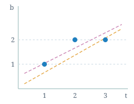
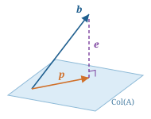
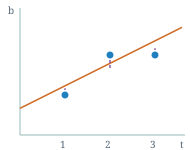

# 第1节　列空间中的最近点

> [!problem] 问题探讨
> 
>
> 在一次实验中测得三组数据：$t=1$ 时 $b=1$，$t=2$ 时 $b=2$，$t=3$ 时 $b=2$。如果 $b$ 与 $t$ 之间满足线性关系 $b=C+Dt$，这三个点就应当落在同一条直线上。
>
> **讨论**
> 1. 能否找到一条直线，同时经过这三个点？
> 2. 如果找不到，应当用什么标准，从无数条直线中挑出"最好"的一条？

> [!focus] 本节聚焦
> - 方程组无解时，"近似解"应当怎样定义？
> - 列空间中离 $\mathbf b$ 最近的点满足什么几何条件？法方程是怎样由这个条件得出的？
> - 最近点与表示它的参数，在唯一性上有什么区别？

上一章讨论线性方程组 $A\mathbf x=\mathbf b$ 时，总是先判断它有没有解。在实际测量中，常见的情形恰好相反：为了减小偶然误差，人们会测量远多于未知量个数的数据，方程的个数因此多于未知量的个数；而数据本身又带有误差，这样的方程组通常无解。 ^p-intro

以问题探讨中的三组数据为例。把它们分别代入 $b=C+Dt$，得到

$$C+D=1,\qquad C+2D=2,\qquad C+3D=2 .$$

由前两个方程得 $C=0$，$D=1$，代入第三个方程却得到 $3=2$，矛盾。

方程组无解，是否意味着这些数据就没有用处了呢？

1805 年，法国数学家勒让德（A.-M. Legendre，1752—1833）在研究彗星轨道的著作中提出了一种处理办法：既然没有一组参数能使每个方程都成立，就选择使各方程误差的平方和最小的那一组参数。这种方法叫作**最小二乘法**（method of least squares）。 ^p-legendre

> [!side] 相关信息 @p-legendre
> 高斯（C. F. Gauss，1777—1855）在 1809 年的著作中称，自己早在 1795 年就已使用这一方法，并用它推算过谷神星的轨道。勒让德对此提出异议，两人关于发明优先权的争论持续多年。

"误差的平方和最小"是一个代数上的要求。把这一要求换成几何语言，问题的结构会变得清楚得多。

## 从代数问题到几何问题

设 $A$ 的列向量为 $\mathbf a_1,\dots,\mathbf a_n$。乘积 $A\mathbf x$ 是这些列向量的线性组合，所有这样的线性组合构成的集合

$$\operatorname{Col}(A)=\{A\mathbf x:\ \mathbf x\in\mathbb R^n\}$$

叫作 $A$ 的**列空间**（column space）。方程组 $A\mathbf x=\mathbf b$ 有解，当且仅当 $\mathbf b$ 属于 $\operatorname{Col}(A)$。 ^p-colspace

在三组数据的例子中，

$$A=\begin{bmatrix}1&1\\1&2\\1&3\end{bmatrix},\qquad \mathbf b=\begin{bmatrix}1\\2\\2\end{bmatrix}.$$

$A$ 的两列张成 $\mathbb R^3$ 中的一个平面，而 $\mathbf b$ 不在这个平面上（图 2-1）。

> [!figure] 图 2-1　$\mathbf b$ 在列空间上的最近点 $\mathbf p$，残差 $\mathbf e$ 垂直于列空间 @p-colspace
> 

"方程组无解"于是有了几何含义：$\mathbf b$ 落在列空间之外。最小二乘法要做的，是先在列空间中找出离 $\mathbf b$ 最近的点 $\mathbf p$，再求出表示 $\mathbf p$ 的参数 $\hat{\mathbf x}$，使 $A\hat{\mathbf x}=\mathbf p$。 ^p-project

> [!res] s.ocw-ses22-p2 @p-project

## 最近点满足的条件

列空间中有无数个点，离 $\mathbf b$ 最近的那一个有什么特征？

设 $\mathbf p=A\hat{\mathbf x}$ 是列空间中离 $\mathbf b$ 最近的点，记 $\mathbf e=\mathbf b-\mathbf p$，叫作**残差**（residual）。在列空间中任取一个方向 $\mathbf v$，把 $\mathbf p$ 沿 $\mathbf v$ 移动到 $\mathbf p+t\mathbf v$，它与 $\mathbf b$ 的距离的平方为

$$\|\mathbf b-(\mathbf p+t\mathbf v)\|^2=\|\mathbf e\|^2-2t\,\mathbf e^{\mathsf T}\mathbf v+t^2\|\mathbf v\|^2 .$$

如果 $\mathbf e^{\mathsf T}\mathbf v\neq0$，取 $t$ 与 $\mathbf e^{\mathsf T}\mathbf v$ 同号且 $|t|$ 足够小，右边就小于 $\|\mathbf e\|^2$，即 $\mathbf p+t\mathbf v$ 比 $\mathbf p$ 更靠近 $\mathbf b$，这与 $\mathbf p$ 是最近点矛盾。因此，对列空间中的任何方向 $\mathbf v$，都有 $\mathbf e^{\mathsf T}\mathbf v=0$，即**残差与列空间正交**。 ^p-orth

> [!side] 相关信息 @p-orth
> 上面的论证只用到了内积的性质。在复数范围内，转置要换成共轭转置，相应的条件写作 $A^{*}(\mathbf b-A\hat{\mathbf x})=\mathbf 0$。

## 法方程

列空间由 $A$ 的各列张成，所以"残差与列空间正交"等价于"残差与 $A$ 的每一列正交"：

$$\mathbf a_i^{\mathsf T}(\mathbf b-A\hat{\mathbf x})=0,\qquad i=1,2,\dots,n .$$

把这 $n$ 个等式合写成矩阵形式 $A^{\mathsf T}(\mathbf b-A\hat{\mathbf x})=\mathbf 0$，整理得

$$A^{\mathsf T}A\,\hat{\mathbf x}=A^{\mathsf T}\mathbf b . \tag{2-1}$$

方程组 (2-1) 叫作**法方程**（normal equations）。"法"即垂直，这个名称记录了方程的来历：它是由残差垂直于列空间这一条件得出的。 ^p-normal-eq

> [!res] s.l15-normal @p-normal-eq

回到问题探讨中的三组数据。计算得

$$A^{\mathsf T}A=\begin{bmatrix}3&6\\6&14\end{bmatrix},\qquad A^{\mathsf T}\mathbf b=\begin{bmatrix}5\\11\end{bmatrix},$$

解法方程得 $C=\tfrac23$，$D=\tfrac12$，最佳直线为 $b=\tfrac23+\tfrac12t$（图 2-2）。此时 ^p-example

$$\mathbf p=\begin{bmatrix}7/6\\5/3\\13/6\end{bmatrix},\qquad \mathbf e=\mathbf b-\mathbf p=\begin{bmatrix}-1/6\\1/3\\-1/6\end{bmatrix}.$$

可以验证，$\mathbf e$ 与 $A$ 的两列 $(1,1,1)^{\mathsf T}$、$(1,2,3)^{\mathsf T}$ 的内积都等于 0。

> [!figure] 图 2-2　最佳直线 $b=\tfrac23+\tfrac12t$，虚线为各点的残差 @p-example
> 

## 点唯一，参数未必唯一

最近点 $\mathbf p$ 只有一个，表示它的参数 $\hat{\mathbf x}$ 是否也只有一组呢？

最近点由 $\mathbf b$ 和列空间共同决定，与选用哪一组向量来张成列空间无关。可以证明，它总是存在并且唯一。

参数 $\hat{\mathbf x}$ 则不同。如果 $A$ 的列向量线性相关，就存在非零向量 $\mathbf d$ 使 $A\mathbf d=\mathbf 0$，此时 $\hat{\mathbf x}$ 与 $\hat{\mathbf x}+\mathbf d$ 给出同一个点 $\mathbf p$，参数便有无穷多组。只有当 $A$ 的列向量线性无关时，$A^{\mathsf T}A$ 才可逆，法方程有唯一解 ^p-unique

$$\hat{\mathbf x}=(A^{\mathsf T}A)^{-1}A^{\mathsf T}\mathbf b .$$

> [!res] s.l15-indep @p-unique

相应地，$\mathbf p=A(A^{\mathsf T}A)^{-1}A^{\mathsf T}\mathbf b$。矩阵 $P=A(A^{\mathsf T}A)^{-1}A^{\mathsf T}$ 把任意向量变为它在列空间上的最近点，叫作向列空间的**投影矩阵**（projection matrix）。 ^p-proj

> [!res] s.wiki-lls-projection @p-proj

表 2-1 归纳了方程组 $A\mathbf x=\mathbf b$ 与最小二乘解在各种情形下的关系。

> [!table] 表 2-1　方程组的解与最小二乘解
> | $A$ 的列向量 | $\mathbf b\in\operatorname{Col}(A)$ | $\mathbf b\notin\operatorname{Col}(A)$ |
> | --- | --- | --- |
> | 线性无关 | $A\mathbf x=\mathbf b$ 有唯一解，最小二乘解就是这个解 | $A\mathbf x=\mathbf b$ 无解，最小二乘解唯一 |
> | 线性相关 | $A\mathbf x=\mathbf b$ 有无穷多解，最小二乘解就是这些解 | $A\mathbf x=\mathbf b$ 无解，最小二乘解有无穷多组 |
> | **最近点 $\mathbf p$** | 在四种情形下都存在并且唯一 | 同左 |

> [!training] 思维训练 · 辨析一种推导
> 有一种流传很广的记法：对方程 $A\mathbf x=\mathbf b$ 两边同时左乘 $A^{\mathsf T}$，就得到 $A^{\mathsf T}A\mathbf x=A^{\mathsf T}\mathbf b$。这个结果与法方程 (2-1) 完全相同。
>
> 1. 当 $A\mathbf x=\mathbf b$ 无解时，这种"推导"的出发点有什么问题？
> 2. 方程 $C\mathbf x=\mathbf d$ 与 $MC\mathbf x=M\mathbf d$ 的解集一定相同吗？请举例说明。
> 3. 这种推导不成立，得到的方程却是对的。请从函数 $f(\mathbf x)=\|\mathbf b-A\mathbf x\|^2$ 取最小值的条件出发，解释其中的原因；再想一想，如果把平方和换成绝对值之和，这种巧合是否还会出现。

> [!training]- 思维训练 · 参考思路
> 1. "两边同乘"的前提是等式成立。$A\mathbf x=\mathbf b$ 无解，就不存在一个使等式成立的 $\mathbf x$ 可供两边同乘，推导没有出发点。
> 2. 不一定。取 $C=\begin{bmatrix}1\\1\end{bmatrix}$，$\mathbf d=\begin{bmatrix}0\\1\end{bmatrix}$，$M=\begin{bmatrix}1&1\end{bmatrix}$：$C x=\mathbf d$ 要求 $x=0$ 且 $x=1$，无解；而 $MCx=M\mathbf d$ 即 $2x=1$，有解 $x=\tfrac12$。左乘一个不可逆的矩阵会扩大解集。
> 3. $f$ 的梯度为 $\nabla f(\mathbf x)=-2A^{\mathsf T}(\mathbf b-A\mathbf x)$，最小值处梯度为零，正好是法方程。"左乘 $A^{\mathsf T}$"之所以碰巧对，是因为平方和的梯度恰好含有 $A^{\mathsf T}$。换成绝对值之和，目标函数在残差为零处不可导，最优条件不再是线性方程，巧合随之消失。

> [!exercise] 练习与应用
> **一、概念检测**
>
> 1. 判断下列表述是否正确。
>    (1) 若 $A\mathbf x=\mathbf b$ 无解，则 $\mathbf b$ 不属于 $A$ 的列空间。（　　）
>    (2) 最小二乘解 $\hat{\mathbf x}$ 总是存在并且唯一。（　　）
>    (3) 若 $A$ 的列向量线性无关，则 $(A^{\mathsf T}A)^{-1}=A^{-1}(A^{\mathsf T})^{-1}$。（　　）
> 2. 设 $\mathbf e$ 为最小二乘问题的残差，下列说法正确的是（　　）
>    A. $\mathbf e=\mathbf 0$　B. $\mathbf e$ 与 $A$ 的每一列正交　C. $\mathbf e$ 与 $\mathbf b$ 正交　D. $\mathbf e$ 属于 $A$ 的列空间
> 3. 用最小二乘法求与三点 $(0,1)$、$(1,2)$、$(2,2)$ 最接近的直线 $b=C+Dt$，并验证残差与 $A$ 的两列都正交。
>
> **二、拓展应用**
>
> 1. 设 $A=\begin{bmatrix}1&2\\2&4\\3&6\end{bmatrix}$，$\mathbf b=\begin{bmatrix}1\\2\\4\end{bmatrix}$。
>    (1) $\mathbf b$ 是否属于 $A$ 的列空间？
>    (2) 列空间中离 $\mathbf b$ 最近的点 $\mathbf p$ 是什么？
>    (3) 最小二乘解有多少组？写出它们的一般形式。
> 2. 在实验中，人们常在同一时刻对同一个量重复测量多次。用直线 $b=C+Dt$ 拟合这样的数据时，矩阵 $A$ 会出现相同的行。这会不会使 $A$ 的列向量线性相关？重复测量对最小二乘解的唯一性有没有影响？
> 3. 勒让德最初提出的标准是"误差的平方和最小"。请从本节的几何观点出发，说明为什么选用平方和，而不是误差的绝对值之和。

^exercises

> [!res] s.l15-split @exercises

> [!exercise]- 答案与解析
> **一、概念检测**
>
> 1. (1) 正确。$A\mathbf x$ 总在列空间中，$A\mathbf x=\mathbf b$ 有解当且仅当 $\mathbf b\in\operatorname{Col}(A)$。
>    (2) 错误。$\hat{\mathbf x}$ 总是存在，但只有 $A$ 的列向量线性无关时才唯一（表 2-1）。**针对的误解**：把"最近点唯一"当成"参数唯一"。
>    (3) 错误。$A$ 一般不是方阵，$A^{-1}$ 不存在，不能把 $(A^{\mathsf T}A)^{-1}$ 拆开。**针对的误解**：把方阵的求逆法则搬到长方阵上。
> 2. B。
>    A 错：$\mathbf e=\mathbf 0$ 意味着 $\mathbf b\in\operatorname{Col}(A)$，即方程组本来有解（把"最小二乘解"当成"精确解"）。
>    C 错：$\mathbf e$ 与 $\mathbf p$ 正交，不与 $\mathbf b$ 正交（$\mathbf e^{\mathsf T}\mathbf b=\|\mathbf e\|^2$，只要 $\mathbf e\neq\mathbf 0$ 就不为零）。
>    D 错：$\mathbf e$ 与列空间正交，除 $\mathbf e=\mathbf 0$ 外不可能属于列空间（把"正交于"与"属于"混淆）。
> 3. $A=\begin{bmatrix}1&0\\1&1\\1&2\end{bmatrix}$，$A^{\mathsf T}A=\begin{bmatrix}3&3\\3&5\end{bmatrix}$，$A^{\mathsf T}\mathbf b=\begin{bmatrix}5\\6\end{bmatrix}$，解得 $C=\tfrac76$，$D=\tfrac12$。残差 $\mathbf e=(-\tfrac16,\tfrac13,-\tfrac16)^{\mathsf T}$，与 $(1,1,1)^{\mathsf T}$、$(0,1,2)^{\mathsf T}$ 的内积都为 0。残差与正文例题完全相同——这组数据只是把正文的 $t$ 平移了 1。
>
> **二、拓展应用**
>
> 1. (1) 不属于。列空间由 $(1,2,3)^{\mathsf T}$ 张成（第二列是第一列的 2 倍），而 $\mathbf b$ 不是它的倍数。
>    (2) $\mathbf p=\dfrac{(1,2,3)\cdot\mathbf b}{(1,2,3)\cdot(1,2,3)}(1,2,3)^{\mathsf T}=\dfrac{17}{14}(1,2,3)^{\mathsf T}=\left(\tfrac{17}{14},\tfrac{17}{7},\tfrac{51}{14}\right)^{\mathsf T}$。
>    (3) 无穷多组：$\hat{\mathbf x}=\left(\tfrac{17}{14},0\right)^{\mathsf T}+s(-2,1)^{\mathsf T}$，$s\in\mathbb R$。它们给出同一个 $\mathbf p$。
> 2. 不会，只要数据中至少有两个不同的时刻。$A$ 的两列是 $(1,\dots,1)^{\mathsf T}$ 与 $(t_1,\dots,t_m)^{\mathsf T}$，它们线性相关当且仅当所有 $t_i$ 相等。重复测量只会增加相同的行，不改变唯一性。
> 3. 平方和就是残差向量欧氏长度的平方，"平方和最小"即"在列空间中找离 $\mathbf b$ 最近的点"，于是有正交条件和线性的法方程。绝对值之和对应另一种"距离"，它没有内积结构，最优条件不是线性方程，解也可能不唯一。
